# RETRO Retrieval Index Record Structure

- Prompt (reference.prompts[0]): What does RETRO keep with each search key in its retrieval index?
- Reference id: figure-retro-index-records (source: Retrieval Transformer)
- Intended kind (reference.spec.diagram.kind): matrix
- Planner kind: tree (not fixed; offered tree | relationship); planner routed to picture: no
- Model kind (first diagram): matrix; all diagrams: matrix
- Selector hit (intended reference among the references sent): yes
- References sent to the author (attempt 0): shape-tree, figure-retro-index-records
- Structure (faithful-ref-v1, reference vs model spec): fully - The diagram matches the reference exactly: the same matrix with the same columns, four records, cell contents, and highlighted rows A and B, plus the caption.
- Factual (factual-v2): 5/5, error no
- Repaired: no; visual fallback: no; authored by google / gemini-3.5-flash-lite
- Time 3868 ms; author tokens in/out 3862/513; cost US$0.002442

| model (408 px) | reference (408 px) |
|---|---|
|  |  |

## Card body (as saved)

The retrieval index in RETRO pairs vector keys with stored text chunks. Each entry associates a search key with both the matching text and its following continuation.

```rh-diagram
{"version":1,"diagram":{"title":"Matched text and continuation in the index","caption":"The highlighted records contribute their matching words and what comes right after.","kind":"matrix","layout":"teaching","columns":["Embedding key","Matching words","Following words"],"rows":[{"id":"A","heading":"Record A","cells":["$[2,3]$","Cedar’s archive","opens Tuesday"]},{"id":"B","heading":"Record B","cells":["$[4,2]$","Archive doors","open Tuesday"]},{"id":"C","heading":"Record C","cells":["$[6,5]$","Cedar saplings","need water"]},{"id":"D","heading":"Record D","cells":["$[5,0]$","Maple Clinic","opens Friday"]}],"emphasis":{"rows":["A","B"]}}}
```

When a chunk is retrieved, the model uses these stored text segments to augment downstream generation. Storing both parts ensures the language model receives precise context.
