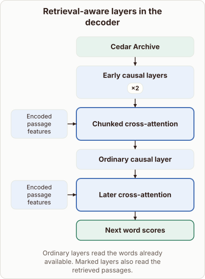

# Retrieval Entry in RETRO

- Prompt (reference.prompts[0]): Where do the retrieved neighbors first enter the RETRO decoder stack?
- Reference id: figure-retro-layer-placement (source: Retrieval Transformer)
- Intended kind (reference.spec.diagram.kind): block-stack
- Planner kind: layers (fixed); planner routed to picture: no
- Model kind (first diagram): block-stack; all diagrams: block-stack
- Selector hit (intended reference among the references sent): yes
- References sent to the author (attempt 0): shape-layers, figure-retro-layer-placement, knn-neighbourhood
- Structure (faithful-ref-v1, reference vs model spec): fully - The diagram's description matches the reference exactly. It has the same block order, the repeat-2 early layers, both changed cross-attention blocks, the encoded passage inputs to each, and the same caption.
- Factual (factual-v2): 5/5, error no
- Repaired: no; visual fallback: no; authored by google / gemini-3.5-flash-lite
- Time 3875 ms; author tokens in/out 4086/577; cost US$0.002669

| model (408 px) | reference (408 px) |
|---|---|
|  |  |

## Card body (as saved)

In the RETRO architecture, retrieved neighbors enter the decoder stack through specialized cross-attention layers inserted periodically between standard causal attention blocks.

```rh-diagram
{"version":1,"diagram":{"title":"Retrieval-aware layers in the decoder","caption":"Ordinary layers read the words already available. Marked layers also read the retrieved passages.","kind":"block-stack","blocks":[{"id":"input","label":"Cedar Archive","role":"embedding"},{"id":"causal","label":"Early causal layers","repeat":2,"role":"attention"},{"id":"retrievala","label":"Chunked cross-attention","role":"changed","inputs":[{"label":"Encoded passage features"}]},{"id":"between","label":"Ordinary causal layer","role":"attention"},{"id":"retrievalb","label":"Later cross-attention","role":"changed","inputs":[{"label":"Encoded passage features"}]},{"id":"out","label":"Next word scores","role":"output"}]}}
```

Before reaching these insertion points, tokens pass through ordinary self-attention layers that process the input sequence without external data.

Once the sequence hits a retrieval-augmented layer, the model conditions its predictions on encoded chunks fetched from an external datastore.
