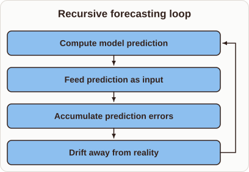
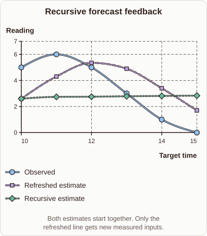

# Recursive Forecast Drift

- Prompt (reference.prompts[0]): Why can a recursive forecast drift when it feeds its own predictions back?
- Reference id: d2l-forecast-feedback-error (source: D2L)
- Intended kind (reference.spec.diagram.kind): coordinate-plot
- Planner kind: cycle (fixed); planner routed to picture: no
- Model kind (first diagram): cycle; all diagrams: cycle
- Selector hit (intended reference among the references sent): yes
- References sent to the author (attempt 0): shape-cycle, d2l-forecast-feedback-error, ml-recursive-vs-direct-forecast
- Structure (faithful-ref-v1, reference vs model spec): not - The reference is a coordinate plot with three series over target time: Observed, a Refreshed estimate, and a Recursive estimate that starts at the same point and flattens. The diagram is a cyclic flow of four steps. It has no axes, no series and no comparison of estimates against observations, so it shows none of the reference structure.
- Factual (factual-v2): 4/5, error no - Broadly accurate; slightly overgeneralized in saying errors always compound/amplify (they may stay bounded in stable models), but this is an acceptable simplification.
- Repaired: no; visual fallback: no; authored by google / gemini-3.5-flash-lite
- Time 3101 ms; author tokens in/out 4384/300; cost US$0.002066

| model (408 px) | reference (408 px) |
|---|---|
|  |  |

## Card body (as saved)

When a model uses its own output as an input for the next step, any small error compounds over time. This feedback loop causes predictions to diverge from true values.

```rh-diagram
{"version":1,"diagram":{"title":"Recursive forecasting loop","kind":"cycle","steps":["Compute model prediction","Feed prediction as input","Accumulate prediction errors","Drift away from reality"]}}
```

Because actual observations stop being used after the first step, the model loses its anchor in reality. The accumulated biases amplify, leading to significant drift in long horizons.
