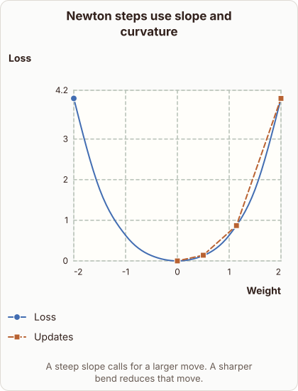

# Newton Optimization and Curvature

- Prompt (reference.prompts[0]): How does Newton optimization use curvature to move to a minimum?
- Reference id: d2l-newton-convex-curvature-steps (source: D2L)
- Intended kind (reference.spec.diagram.kind): coordinate-plot
- Planner kind: coordinate-plot (fixed); planner routed to picture: no
- Model kind (first diagram): coordinate-plot; all diagrams: coordinate-plot
- Selector hit (intended reference among the references sent): yes
- References sent to the author (attempt 0): shape-coordinate-plot, d2l-newton-convex-curvature-steps, gradient-descent-contours
- Structure (faithful-ref-v1, reference vs model spec): fully - The diagram's description matches the reference exactly. It has the same title, axes, Loss series, Updates series and caption.
- Factual (factual-v2): 3/5, error yes - Says 'gentle slopes prompt larger updates', but step size grows with slope and shrinks with curvature. Gentle slope (small gradient) gives a smaller step; the claim confuses slope with curvature and contradicts the diagram.
- Repaired: no; visual fallback: no; authored by google / gemini-3.5-flash-lite
- Time 3717 ms; author tokens in/out 4388/815; cost US$0.003354

| model (408 px) | reference (408 px) |
|---|---|
|  |  |

## Card body (as saved)

Newton optimization finds the minimum of a function by approximating it locally with a quadratic Taylor series, using both the gradient and the Hessian matrix.

```rh-diagram
{"version":1,"diagram":{"title":"Newton steps use slope and curvature","caption":"A steep slope calls for a larger move. A sharper bend reduces that move.","kind":"coordinate-plot","x":{"label":"Weight","min":-2,"max":2,"scale":"linear"},"y":{"label":"Loss","min":0,"max":4.2},"series":[{"label":"Loss","kind":"line","points":[{"x":-2,"y":4},{"x":-1.5,"y":1.76},{"x":-1,"y":0.63},{"x":-0.5,"y":0.13},{"x":0,"y":0},{"x":0.5,"y":0.13},{"x":1,"y":0.63},{"x":1.5,"y":1.76},{"x":2,"y":4}]},{"label":"Updates","kind":"line","smooth":false,"points":[{"x":2,"y":4},{"x":1.14,"y":0.87},{"x":0.5,"y":0.14},{"x":0,"y":0}]}]}}
```

The gradient provides the slope and direction of steepest descent, while the Hessian measures local curvature to scale the step size appropriately.

When the curvature is sharp, the algorithm takes smaller steps to avoid overshooting, whereas gentle slopes prompt larger updates toward the minimum.
