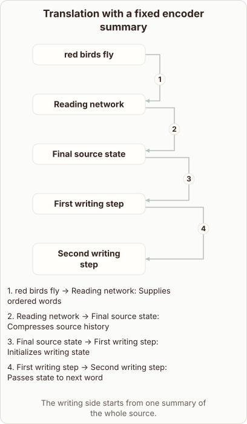

# The Fixed Summary Bottleneck in RNN Translation

- Prompt (reference.prompts[0]): Why is one fixed summary a bottleneck for an RNN translator?
- Reference id: d2l-recurrent-translation-fixed-context (source: D2L)
- Intended kind (reference.spec.diagram.kind): relationship
- Planner kind: block-stack (not fixed; offered block-stack | relationship); planner routed to picture: no
- Model kind (first diagram): relationship; all diagrams: relationship
- Selector hit (intended reference among the references sent): yes
- References sent to the author (attempt 0): shape-block-stack, d2l-recurrent-translation-fixed-context
- Structure (faithful-ref-v1, reference vs model spec): fully - The diagram's nodes, edges, edge labels, title and caption match the reference exactly.
- Factual (factual-v2): 4/5, error no - Accurate description of the classic seq2seq fixed-context bottleneck. Minor simplification: 'sole starting state' ignores variants that feed the context at every step, and the loss of detail is stated more absolutely than the evidence supports.
- Repaired: no; visual fallback: no; authored by google / gemini-3.5-flash-lite
- Time 3191 ms; author tokens in/out 3855/343; cost US$0.002014

| model (408 px) | reference (408 px) |
|---|---|
|  |  |

## Card body (as saved)

An RNN translator reads a source sentence word by word and compresses its entire history into a single vector.

```rh-diagram
{"version":1,"diagram":{"title":"Translation with a fixed encoder summary","caption":"The writing side starts from one summary of the whole source.","kind":"relationship","layout":"graph","nodes":[{"id":"source","label":"red birds fly"},{"id":"enc","label":"Reading network"},{"id":"summary","label":"Final source state"},{"id":"d1","label":"First writing step"},{"id":"d2","label":"Second writing step"}],"edges":[{"from":"source","to":"enc","label":"Supplies ordered words"},{"from":"enc","to":"summary","label":"Compresses source history"},{"from":"summary","to":"d1","label":"Initializes writing state"},{"from":"d1","to":"d2","label":"Passes state to next word"}]}}
```

This single vector acts as the sole starting state for the decoder, forcing all information about the source to fit through this narrow channel.

As sentences grow longer, this fixed summary loses details from earlier words, degrading translation quality for distant parts of the text.
