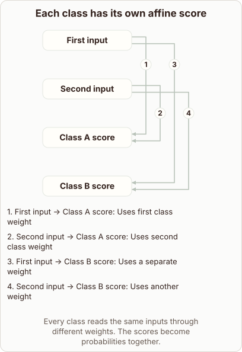

# Raw Class Scores in Softmax Regression

- Prompt (reference.prompts[0]): How does softmax regression create its raw class scores?
- Reference id: d2l-softmax-affine-class-scores (source: D2L)
- Intended kind (reference.spec.diagram.kind): relationship
- Planner kind: layers (not fixed; offered layers | flow); planner routed to picture: no
- Model kind (first diagram): relationship; all diagrams: relationship
- Selector hit (intended reference among the references sent): yes
- References sent to the author (attempt 0): shape-layers, d2l-softmax-affine-class-scores, regression-residuals
- Structure (faithful-ref-v1, reference vs model spec): fully - The diagram matches the reference exactly. It has the same two inputs, the same two class scores, and the same four weighted edges, with the same title and caption.
- Factual (factual-v2): 4/5, error no - Minor imprecision: 'weight matrices' (really one matrix with a row per class), and 'higher score = confidence' is a simplification, since scores only become probabilities after softmax.
- Repaired: no; visual fallback: no; authored by google / gemini-3.5-flash-lite
- Time 3464 ms; author tokens in/out 4099/424; cost US$0.00229

| model (408 px) | reference (408 px) |
|---|---|
|  |  |

## Card body (as saved)

Softmax regression computes raw class scores using an affine transformation. Each target class maintains its own distinct set of weights and a bias term.

```rh-diagram
{"version":1,"diagram":{"title":"Each class has its own affine score","caption":"Every class reads the same inputs through different weights. The scores become probabilities together.","kind":"relationship","layout":"graph","nodes":[{"id":"a","label":"First input"},{"id":"b","label":"Second input"},{"id":"x","label":"Class A score"},{"id":"y","label":"Class B score"}],"edges":[{"from":"a","to":"x","label":"Uses first class weight"},{"from":"b","to":"x","label":"Uses second class weight"},{"from":"a","to":"y","label":"Uses a separate weight"},{"from":"b","to":"y","label":"Uses another weight"}]}}
```

The model multiplies the input feature vector by these weight matrices and adds the bias. This produces a raw, unconstrained score for every individual class.

Higher score values indicate stronger model confidence for that category.
