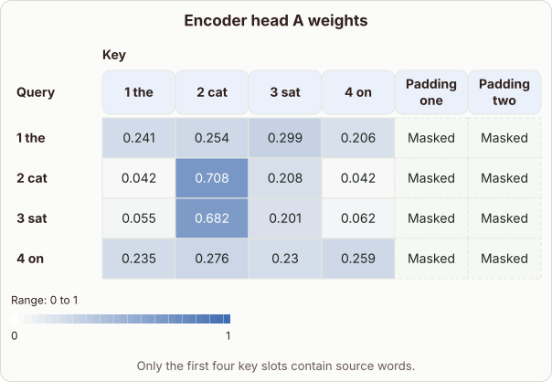

# Comparing Encoder Self-Attention Heatmaps

- Prompt (reference.prompts[0]): How can I compare encoder self-attention heatmaps from different heads?
- Reference id: d2l-transformer-encoder-head-weight-grids (source: D2L)
- Intended kind (reference.spec.diagram.kind): heatmap
- Planner kind: comparison (fixed); planner routed to picture: no
- Model kind (first diagram): heatmap; all diagrams: heatmap, heatmap
- Selector hit (intended reference among the references sent): yes
- References sent to the author (attempt 0): shape-comparison, d2l-transformer-encoder-head-weight-grids
- Structure (faithful-ref-v1, reference vs model spec): fully - The diagram's description is identical to the reference: same heatmap, range, rows, columns, values, masked padding cells and caption.
- Factual (factual-v2): 4/5, error no - Minor overreach: local-context and first-token heads are positional patterns, not necessarily 'syntactic', and the diagrams show no weights to support the head descriptions.
- Repaired: no; visual fallback: no; authored by google / gemini-3.5-flash-lite
- Time 4186 ms; author tokens in/out 4227/1181; cost US$0.004221

| model (408 px) | reference (408 px) |
|---|---|
|  |  |

## Card body (as saved)

Comparing attention heads requires plotting their score matrices side by side under a shared colour scale. Each cell in the grid displays the weight assigned from a query word to a key word.

```rh-diagram
{"version":1,"diagram":{"title":"Encoder head A weights","caption":"Only the first four key slots contain source words.","kind":"heatmap","rowLabel":"Query","columnLabel":"Key","columns":["1 the","2 cat","3 sat","4 on","Padding one","Padding two"],"rows":[{"label":"1 the","cells":[0.241,0.254,0.299,0.206,null,null]},{"label":"2 cat","cells":[0.042,0.708,0.208,0.042,null,null]},{"label":"3 sat","cells":[0.055,0.682,0.201,0.062,null,null]},{"label":"4 on","cells":[0.235,0.276,0.23,0.259,null,null]}],"range":{"min":0,"max":1}}}
```

Padding positions are masked out so they do not receive attention or skew the gradient dynamics during training. This masking ensures both heads evaluate over the identical valid token domain.

```rh-diagram
{"version":1,"diagram":{"title":"Encoder head B weights","caption":"The available positions stay the same. The head can give them different weights.","kind":"heatmap","rowLabel":"Query","columnLabel":"Key","columns":["1 the","2 cat","3 sat","4 on","Padding one","Padding two"],"rows":[{"label":"1 the","cells":[0.563,0.244,0.111,0.082,null,null]},{"label":"2 cat","cells":[0.469,0.261,0.156,0.114,null,null]},{"label":"3 sat","cells":[0.551,0.248,0.131,0.07,null,null]},{"label":"4 on","cells":[0.525,0.25,0.115,0.11,null,null]}],"range":{"min":0,"max":1}}}
```

Inspecting these heatmaps reveals specialized syntactic roles. Head A focuses heavily on local context, whereas head B distributes broad weight towards initial tokens.
