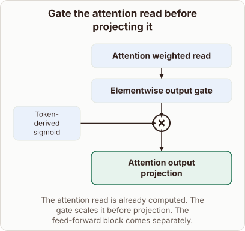

# Where the output gate acts in attention

- Prompt (reference.prompts[0]): Where does the output gate act after attention has read the token values?
- Reference id: figure-attention-output-gate (source: Architecture gallery)
- Intended kind (reference.spec.diagram.kind): block-stack
- Planner kind: flow (not fixed; offered flow | token-links); planner routed to picture: no
- Model kind (first diagram): block-stack; all diagrams: block-stack
- Selector hit (intended reference among the references sent): yes
- References sent to the author (attempt 0): shape-flow, figure-attention-output-gate
- Structure (faithful-ref-v1, reference vs model spec): fully - The diagram matches the reference. It has the same three-block chain (read → elementwise gate → output projection). The token-derived sigmoid feeds the gate through a multiply join, and the title and caption are the same.
- Factual (factual-v2): 4/5, error no - Accurately describes gated attention (output gate applied after the weighted value read, before the output projection). 'Derived directly from the tokens' is slightly loose, since the gate is computed from the current token's hidden state, but a teacher would accept it.
- Repaired: no; visual fallback: no; authored by google / gemini-3.5-flash-lite
- Time 2600 ms; author tokens in/out 3884/496; cost US$0.002406

| model (408 px) | reference (408 px) |
|---|---|
|  |  |

## Card body (as saved)

After the attention mechanism gathers values from the sequence, the resulting vector represents the weighted read.

Before this read goes to the final linear projection, an elementwise output gate scales its values based on the current token.

```rh-diagram
{"version":1,"diagram":{"title":"Gate the attention read before projecting it","caption":"The attention read is already computed. The gate scales it before projection. The feed-forward block comes separately.","kind":"block-stack","blocks":[{"id":"read","label":"Attention weighted read","role":"attention"},{"id":"gate","label":"Elementwise output gate","role":"attention","merge":"multiply","inputs":[{"label":"Token-derived sigmoid"}]},{"id":"out","label":"Attention output projection","role":"output"}]}}
```

This gating operation multiplies the attention read by a sigmoid activation derived directly from the tokens. It controls how much of the gathered information flows forward into the projection step.

The feed-forward blocks and residual connections operate separately downstream.
