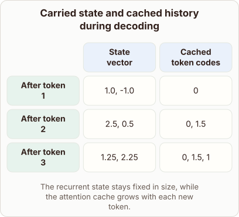
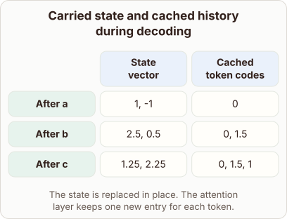

# Decoding growth in hybrid models

- Prompt (reference.prompts[0]): What grows during decoding in a hybrid model with recurrent state and an attention cache?
- Reference id: figure-gallery-hybrid-state-and-cache-growth (source: Architecture gallery)
- Intended kind (reference.spec.diagram.kind): matrix
- Planner kind: block-stack (not fixed; offered block-stack | token-links); planner routed to picture: no
- Model kind (first diagram): matrix; all diagrams: matrix
- Selector hit (intended reference among the references sent): yes
- References sent to the author (attempt 0): shape-block-stack, figure-gallery-hybrid-state-and-cache-growth
- Structure (faithful-ref-v1, reference vs model spec): fully - The diagram is a matrix with the same two columns and three rows. The cell values match the reference. The state vector stays two numbers wide and the cache grows by one entry per token. Only the row headings and caption wording differ, which is optional.
- Factual (factual-v2): 5/5, error no
- Repaired: no; visual fallback: no; authored by google / gemini-3.5-flash-lite
- Time 3064 ms; author tokens in/out 4036/594; cost US$0.002696

| model (408 px) | reference (408 px) |
|---|---|
|  |  |

## Card body (as saved)

During text generation, hybrid architectures combine recurrent mechanisms with standard attention layers to process sequences efficiently.

The recurrent state vector maintains a fixed size regardless of how many tokens have been processed so far. This constant memory footprint is achieved by updating internal hidden vectors in place at every step.

```rh-diagram
{"version":1,"diagram":{"title":"Carried state and cached history during decoding","caption":"The recurrent state stays fixed in size, while the attention cache grows with each new token.","kind":"matrix","layout":"teaching","columns":["State vector","Cached token codes"],"rows":[{"id":"r0","heading":"After token 1","cells":["1.0, -1.0","0"]},{"id":"r1","heading":"After token 2","cells":["2.5, 0.5","0, 1.5"]},{"id":"r2","heading":"After token 3","cells":["1.25, 2.25","0, 1.5, 1"]}]}}
```

In contrast, the attention cache must store past keys and values to compute accurate context for future tokens.

As each new token is generated, the length of the sequence increases, causing the cache size to grow linearly. Managing this growing cache is critical for controlling memory usage during long context windows.
