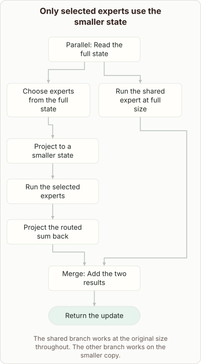

# Latent Mixture of Experts Compression

- Prompt (reference.prompts[0]): What is compressed inside a latent mixture of experts?
- Reference id: figure-latent-expert-widths (source: Architecture gallery)
- Intended kind (reference.spec.diagram.kind): flow
- Planner kind: transformation (not fixed; offered transformation | block-stack); planner routed to picture: no
- Model kind (first diagram): transformation; all diagrams: transformation
- Selector hit (intended reference among the references sent): yes
- References sent to the author (attempt 0): shape-transformation, figure-latent-expert-widths
- Structure (faithful-ref-v1, reference vs model spec): not - The diagram shows only a single projection from full state x to latent z. It has none of the reference's parallel paths: the shared expert at full size, the selected experts on the smaller state, the projection back, or the merge and output. It also routes from the compressed state, which contradicts the reference's choosing experts from the full state.
- Factual (factual-v2): 4/5, error no - "Latent MoE" is not one fixed standard architecture, but the description is a reasonable one: project down, route and compute in the latent space, then project back up. The claim that "preserving essential semantic features" is a mild simplification. The card never mentions projecting back up, which is an omission rather than an error.
- Repaired: no; visual fallback: no; authored by google / gemini-3.5-flash-lite
- Time 2400 ms; author tokens in/out 3984/439; cost US$0.002293

| model (408 px) | reference (408 px) |
|---|---|
|  |  |

## Card body (as saved)

In a latent mixture of experts, the model projects the high-dimensional token representations into a much smaller latent space before routing them to specific experts.

```rh-diagram
{"version":1,"diagram":{"title":"Compress the state into a smaller representation","caption":"Projecting the full state down allows routed experts to process compressed tokens.","kind":"transformation","before":{"label":"Full State","items":["$x \\in \\mathbb{R}^{d}$","Original dimension"]},"after":{"label":"Latent State","items":["$z \\in \\mathbb{R}^{m}$","$m < d$ compressed"]},"operation":"Project down to a lower-dimensional latent space","links":[{"from":0,"to":0,"label":"Linear projection"}]}}
```

By compressing the state vector $x$ into a lower-dimensional vector $z$, the routing and expert computations require fewer floating-point operations while preserving essential semantic features.
