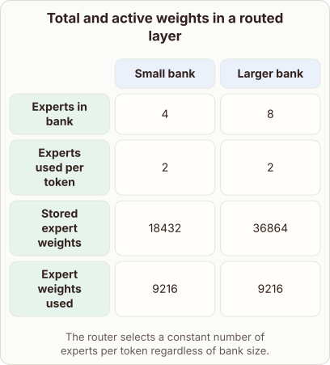
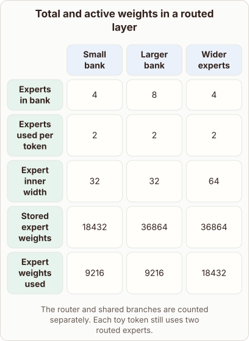

# Doubling an Expert Bank

- Prompt (reference.prompts[0]): How can a model double its expert bank but use the same number of expert weights per token?
- Reference id: figure-routed-expert-parameter-split (source: Architecture gallery)
- Intended kind (reference.spec.diagram.kind): matrix
- Planner kind: token-links (not fixed; offered token-links | comparison); planner routed to picture: no
- Model kind (first diagram): matrix; all diagrams: matrix
- Selector hit (intended reference among the references sent): yes
- References sent to the author (attempt 0): shape-token-links, figure-routed-expert-parameter-split
- Structure (faithful-ref-v1, reference vs model spec): partly - The diagram is a matrix with matching rows and values for the Small bank and Larger bank columns. It leaves out the "Wider experts" column and the "Expert inner width" row, so it misses the contrast where wider experts raise the active weights.
- Factual (factual-v2): 5/5, error no
- Repaired: no; visual fallback: no; authored by google / gemini-3.5-flash-lite
- Time 2750 ms; author tokens in/out 3888/446; cost US$0.002282

| model (408 px) | reference (408 px) |
|---|---|
|  |  |

## Card body (as saved)

Mixture of experts models scale their capacity by increasing the total number of specialized sub-networks available in the bank. Doubling the size of this expert bank increases total storage requirements proportionally.

```rh-diagram
{"version":1,"diagram":{"title":"Total and active weights in a routed layer","caption":"The router selects a constant number of experts per token regardless of bank size.","kind":"matrix","layout":"teaching","columns":["Small bank","Larger bank"],"rows":[{"id":"r1","heading":"Experts in bank","cells":["4","8"]},{"id":"r2","heading":"Experts used per token","cells":["2","2"]},{"id":"r3","heading":"Stored expert weights","cells":["18432","36864"]},{"id":"r4","heading":"Expert weights used","cells":["9216","9216"]}]}}
```

Despite the larger bank, the routing mechanism restricts each token to activate only a fixed subset of experts.

Because active capacity per token remains constant, compute cost during a forward pass does not grow with the bank size.
