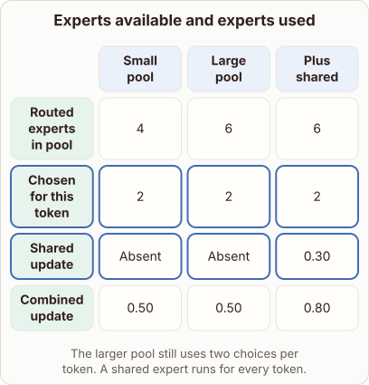

# Adding a Shared Expert in Routed Layers

- Prompt (reference.prompts[0]): What changes when a routed expert layer adds a shared expert?
- Reference id: figure-routed-vs-shared-experts (source: Architecture gallery)
- Intended kind (reference.spec.diagram.kind): matrix
- Planner kind: block-stack (not fixed; offered block-stack | transformation); planner routed to picture: no
- Model kind (first diagram): matrix; all diagrams: matrix
- Selector hit (intended reference among the references sent): yes
- References sent to the author (attempt 0): shape-block-stack, figure-routed-vs-shared-experts, general-layers-2
- Structure (faithful-ref-v1, reference vs model spec): fully - The diagram is identical to the reference. It has the same matrix kind, columns, rows, cell values, highlighted rows and caption.
- Factual (factual-v2): 4/5, error no - The prose and matrix are consistent, and 0.50 + 0.30 = 0.80. The word 'guarantees' for capturing general features is slightly overstated, but acceptable as a simplification.
- Repaired: no; visual fallback: no; authored by google / gemini-3.5-flash-lite
- Time 3128 ms; author tokens in/out 3943/536; cost US$0.002523

| model (408 px) | reference (408 px) |
|---|---|
|  |  |

## Card body (as saved)

A standard routed expert layer selects a small subset of available feedforward networks for each incoming token using a gating router.

Adding a shared expert introduces a dedicated pathway that processes every token unconditionally alongside the dynamically routed selections.

```rh-diagram
{"version":1,"diagram":{"title":"Experts available and experts used","caption":"The larger pool still uses two choices per token. A shared expert runs for every token.","kind":"matrix","layout":"teaching","columns":["Small pool","Large pool","Plus shared"],"rows":[{"id":"r1","heading":"Routed experts in pool","cells":["4","6","6"]},{"id":"r2","heading":"Chosen for this token","cells":["2","2","2"]},{"id":"r3","heading":"Shared update","cells":["Absent","Absent","0.30"]},{"id":"r4","heading":"Combined update","cells":["0.50","0.50","0.80"]}],"emphasis":{"rows":["r2","r3"]}}}
```

This architecture guarantees that general features are captured without relying solely on the routing mechanism.

The final representation combines the outputs from both the shared expert and the conditionally selected routed experts.
