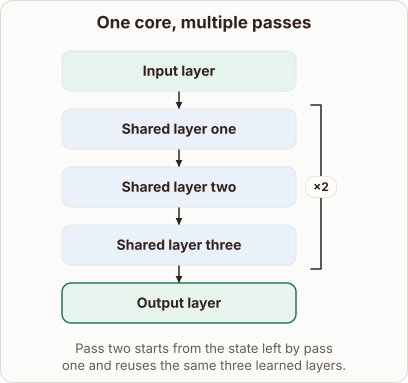

# Running Decoder Blocks Twice

- Prompt (reference.prompts[0]): How does a decoder get deeper by running the same blocks twice?
- Reference id: ml-architecture-shared-core (source: Architecture gallery)
- Intended kind (reference.spec.diagram.kind): block-stack
- Planner kind: block-stack (fixed); planner routed to picture: no
- Model kind (first diagram): block-stack; all diagrams: block-stack
- Selector hit (intended reference among the references sent): yes
- References sent to the author (attempt 0): shape-block-stack, ml-architecture-shared-core
- Structure (faithful-ref-v1, reference vs model spec): fully - The diagram's description matches the reference exactly. It has the same block order, with a repeat of the three shared layers 2 times between the input and output layers.
- Factual (factual-v2): 4/5, error no - Accurate overall. "Keeping memory overhead low" holds for parameter memory, but activation and KV-cache memory still grow with the number of passes. A teacher would accept this as a simplification.
- Repaired: no; visual fallback: no; authored by google / gemini-3.5-flash-lite
- Time 2733 ms; author tokens in/out 3801/507; cost US$0.002408

| model (408 px) | reference (408 px) |
|---|---|
|  |  |

## Card body (as saved)

A recurrent decoder increases effective depth without adding new weights by feeding intermediate representations back through the exact same set of layers multiple times.

```rh-diagram
{"version":1,"diagram":{"title":"One core, multiple passes","caption":"Pass two starts from the state left by pass one and reuses the same three learned layers.","kind":"block-stack","blocks":[{"id":"prefix","label":"Input layer","role":"embedding"},{"id":"core-a","label":"Shared layer one","repeat":2,"repeatTo":"core-c","role":"attention"},{"id":"core-b","label":"Shared layer two","role":"attention"},{"id":"core-c","label":"Shared layer three","role":"attention"},{"id":"tail","label":"Output layer","role":"output"}]}}
```

During execution, the model passes hidden states through the shared core blocks sequentially, updating the activations and then feeding those updated values back into the start of the core for another pass.

This loop allows parameters to compute richer features while keeping memory overhead low, effectively simulating a much deeper network through iterative refinement.
