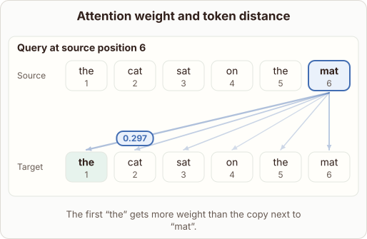

# Self-Attention Distance and Weight

- Prompt (reference.prompts[0]): Can self-attention give a distant word more weight than its neighbor?
- Reference id: ml-transformer-attention-across-distance (source: Transformer)
- Intended kind (reference.spec.diagram.kind): token-links
- Planner kind: token-links (fixed); planner routed to picture: no
- Model kind (first diagram): token-links; all diagrams: token-links
- Selector hit (intended reference among the references sent): yes
- References sent to the author (attempt 0): shape-token-links, ml-transformer-attention-across-distance, knn-neighbourhood
- Structure (faithful-ref-v1, reference vs model spec): fully - The diagram matches the reference exactly. It has the same token-links kind, the same source and target tokens, and the same query "mat" at position 6 with identical weights. It also notes that the weights are normalized.
- Factual (factual-v2): 4/5, error no - "Ignoring linear distance entirely" is a slight overstatement, since positional encodings or relative-position biases let position influence attention. Otherwise it is an acceptable simplification, and the example is plausible as an illustration.
- Repaired: no; visual fallback: no; authored by google / gemini-3.5-flash-lite
- Time 2468 ms; author tokens in/out 4041/286; cost US$0.001928

| model (408 px) | reference (408 px) |
|---|---|
|  |  |

## Card body (as saved)

Self-attention computes weights between words directly through dot products, ignoring linear distance in the sequence entirely.

```rh-diagram
{"version":1,"diagram":{"title":"Attention weight and token distance","caption":"The first “the” gets more weight than the copy next to “mat”.","kind":"token-links","source":["the","cat","sat","on","the","mat"],"target":["the","cat","sat","on","the","mat"],"queries":[{"index":5,"weights":[0.297,0.18,0.126,0.075,0.105,0.217]}],"normalized":true}}
```

Because connections depend on semantic relevance rather than proximity, a distant word can receive a much higher attention weight than an immediate neighbor.

In the example above, the final word attends more strongly to the first word than to the closer word right beside it.
