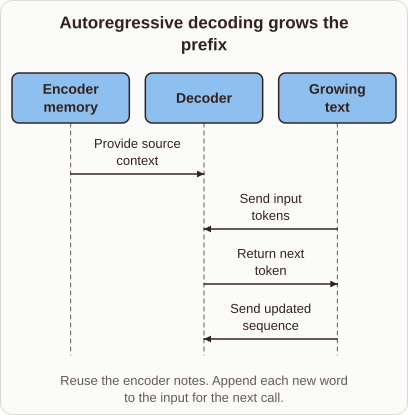
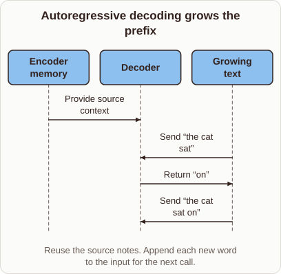

# Transformer Autoregressive Decoding

- Prompt (reference.prompts[0]): How does Transformer decoding append a word and feed it back in?
- Reference id: ml-transformer-autoregressive-prefix (source: Transformer)
- Intended kind (reference.spec.diagram.kind): sequence
- Planner kind: sequence (reference override; the planner said cycle) (fixed); planner routed to picture: no
- Model kind (first diagram): sequence; all diagrams: sequence
- Selector hit (intended reference among the references sent): yes
- References sent to the author (attempt 0): shape-sequence, ml-transformer-autoregressive-prefix
- Structure (faithful-ref-v1, reference vs model spec): fully - The diagram has the same sequence structure as the reference. It uses the same three actors and the same four messages in the same order. The labels are generalized (e.g. "Send input tokens" instead of "Send “the cat sat”"), which is an optional difference.
- Factual (factual-v2): 5/5, error no
- Repaired: no; visual fallback: no; authored by google / gemini-3.5-flash-lite
- Time 2264 ms; author tokens in/out 3866/444; cost US$0.00227

| model (408 px) | reference (408 px) |
|---|---|
|  |  |

## Card body (as saved)

Autoregressive decoding generates text one step at a time. The model computes probabilities for the next token given all previous tokens.

```rh-diagram
{"version":1,"diagram":{"title":"Autoregressive decoding grows the prefix","caption":"Reuse the encoder notes. Append each new word to the input for the next call.","kind":"sequence","actors":[{"id":"memory","label":"Encoder memory"},{"id":"decoder","label":"Decoder"},{"id":"prefix","label":"Growing text"}],"messages":[{"from":"memory","to":"decoder","label":"Provide source context"},{"from":"prefix","to":"decoder","label":"Send input tokens"},{"from":"decoder","to":"prefix","label":"Return next token"},{"from":"prefix","to":"decoder","label":"Send updated sequence"}]}}
```

Once a new token is produced, it is appended to the existing sequence. This expanded prefix becomes the input for the subsequent decoding pass.
