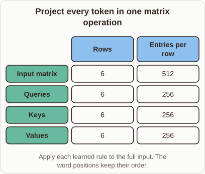

# Batched Token Projections

- Prompt (reference.prompts[0]): How does a Transformer project all tokens into Q, K, and V at once?
- Reference id: ml-transformer-batched-qkv (source: Transformer)
- Intended kind (reference.spec.diagram.kind): matrix
- Planner kind: matrix (reference override; the planner said transformation); planner routed to picture: no
- Model kind (first diagram): matrix; all diagrams: matrix
- Selector hit (intended reference among the references sent): yes
- References sent to the author (attempt 0): shape-matrix, ml-transformer-batched-qkv, knn-k-validation
- Structure (faithful-ref-v1, reference vs model spec): fully - The diagram matches the reference exactly. It is a matrix with the same title, columns, four rows (Input, Queries, Keys, Values) and values, plus the same caption.
- Factual (factual-v2): 5/5, error no
- Repaired: no; visual fallback: no; authored by google / gemini-3.5-flash-lite
- Time 2576 ms; author tokens in/out 4031/404; cost US$0.00222

| model (408 px) | reference (408 px) |
|---|---|
|  |  |

## Card body (as saved)

Transformers compute $Q$, $K$, and $V$ by packing every token vector into a single input matrix.

```rh-diagram
{"version":1,"diagram":{"title":"Project every token in one matrix operation","caption":"Apply each learned rule to the full input. The word positions keep their order.","kind":"matrix","columns":["Rows","Entries per row"],"rows":[{"heading":"Input matrix","cells":["6","512"]},{"heading":"Queries","cells":["6","256"]},{"heading":"Keys","cells":["6","256"]},{"heading":"Values","cells":["6","256"]}]}}
```

Multiplying this combined matrix by learned weight matrices transforms all token features in parallel. Token order is fully preserved during this batch operation.
