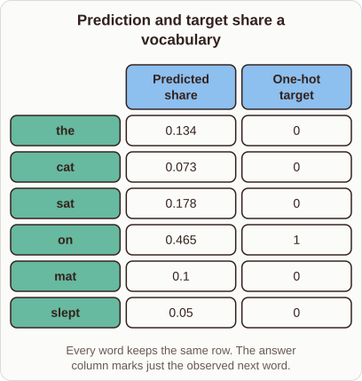

# Comparing Probability Vectors with One-Hot Targets

- Prompt (reference.prompts[0]): How does next-token training compare a probability vector with a one-hot target?
- Reference id: ml-transformer-one-hot-target (source: Transformer)
- Intended kind (reference.spec.diagram.kind): matrix
- Planner kind: matrix (reference override; the planner said comparison); planner routed to picture: no
- Model kind (first diagram): matrix; all diagrams: matrix
- Selector hit (intended reference among the references sent): yes
- References sent to the author (attempt 0): shape-matrix, ml-transformer-one-hot-target, one-hot-encoding
- Structure (faithful-ref-v1, reference vs model spec): fully - The diagram matches the reference matrix. It has the same six word rows, the Predicted share and One-hot target columns, identical values, and a single 1 on "on".
- Factual (factual-v2): 5/5, error no
- Repaired: no; visual fallback: no; authored by google / gemini-3.5-flash-lite
- Time 2806 ms; author tokens in/out 3975/402; cost US$0.002198

| model (408 px) | reference (408 px) |
|---|---|
|  |  |

## Card body (as saved)

Next-token training evaluates model predictions by comparing the output probability distribution against a ground-truth vector.

```rh-diagram
{"version":1,"diagram":{"title":"Prediction and target share a vocabulary","caption":"Every word keeps the same row. The answer column marks just the observed next word.","kind":"matrix","columns":["Predicted share","One-hot target"],"rows":[{"heading":"the","cells":["0.134","0"]},{"heading":"cat","cells":["0.073","0"]},{"heading":"sat","cells":["0.178","0"]},{"heading":"on","cells":["0.465","1"]},{"heading":"mat","cells":["0.1","0"]},{"heading":"slept","cells":["0.05","0"]}]}}
```

The predicted shares assign a decimal value to every vocabulary term, summing to one. Meanwhile, the one-hot target places a single $1$ at the exact observed next word and $0$ everywhere else.
