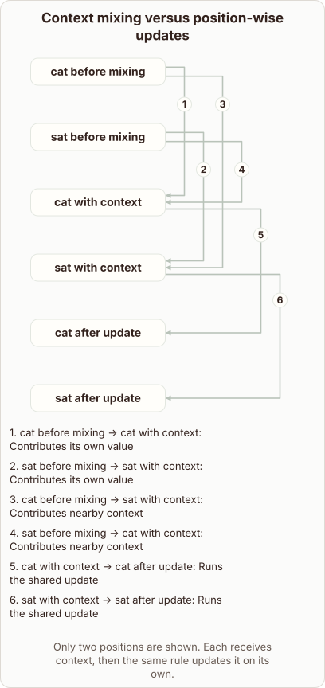

# Attention Mixing Versus Position-Wise Updates

- Prompt (reference.prompts[0]): Why does attention mix words while the feed-forward network is position-wise?
- Reference id: ml-transformer-positionwise-feedforward (source: Transformer)
- Intended kind (reference.spec.diagram.kind): relationship
- Planner kind: relationship (reference override; the planner said token-links) (fixed); planner routed to picture: no
- Model kind (first diagram): relationship; all diagrams: relationship
- Selector hit (intended reference among the references sent): yes
- References sent to the author (attempt 0): shape-relationship, ml-transformer-positionwise-feedforward
- Structure (faithful-ref-v1, reference vs model spec): fully - The diagram's nodes, edges and labels match the reference exactly. That covers the six nodes, the own-value and cross-context edges, and the shared-update edges.
- Factual (factual-v2): 5/5, error no
- Repaired: no; visual fallback: no; authored by google / gemini-3.5-flash-lite
- Time 2632 ms; author tokens in/out 3930/421; cost US$0.002232

| model (408 px) | reference (408 px) |
|---|---|
|  |  |

## Card body (as saved)

Attention layers allow tokens to look at all other tokens in the sequence. This enables the model to build contextual representations that capture relationships across the entire input.

```rh-diagram
{"version":1,"diagram":{"title":"Context mixing versus position-wise updates","caption":"Only two positions are shown. Each receives context, then the same rule updates it on its own.","kind":"relationship","layout":"graph","nodes":[{"id":"cat","label":"cat before mixing"},{"id":"sat","label":"sat before mixing"},{"id":"catMix","label":"cat with context"},{"id":"satMix","label":"sat with context"},{"id":"catNext","label":"cat after update"},{"id":"satNext","label":"sat after update"}],"edges":[{"from":"cat","to":"catMix","label":"Contributes its own value"},{"from":"sat","to":"satMix","label":"Contributes its own value"},{"from":"cat","to":"satMix","label":"Contributes nearby context"},{"from":"sat","to":"catMix","label":"Contributes nearby context"},{"from":"catMix","to":"catNext","label":"Runs the shared update"},{"from":"satMix","to":"satNext","label":"Runs the shared update"}]}}
```

In contrast, the feed-forward network processes each position independently. It applies the same learned transformation to every token vector without mixing information between different locations.
