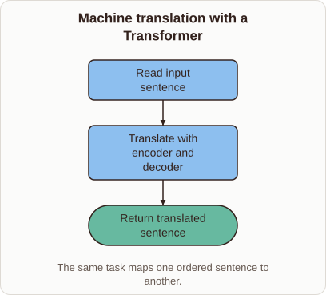
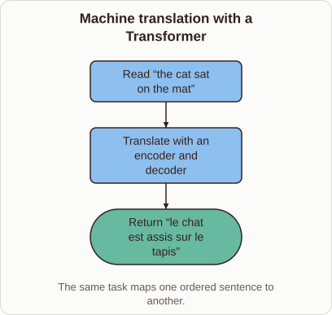

# Transformer Machine Translation Mechanism

- Prompt (reference.prompts[0]): How does a transformer translate a sentence from one language into another?
- Reference id: ml-transformer-translation-task (source: Transformer)
- Intended kind (reference.spec.diagram.kind): flow
- Planner kind: flow (reference override; the planner said block-stack) (fixed); planner routed to picture: no
- Model kind (first diagram): flow; all diagrams: flow
- Selector hit (intended reference among the references sent): yes
- References sent to the author (attempt 0): shape-flow, ml-transformer-translation-task
- Structure (faithful-ref-v1, reference vs model spec): fully - The diagram is a three-step flow: read the input, translate with an encoder and decoder, then return the translation. This matches the reference structure and edges. It uses generic labels instead of the example sentences, which is an optional difference.
- Factual (factual-v2): 5/5, error no
- Repaired: no; visual fallback: no; authored by google / gemini-3.5-flash-lite
- Time 2281 ms; author tokens in/out 3857/373; cost US$0.00209

| model (408 px) | reference (408 px) |
|---|---|
|  |  |

## Card body (as saved)

Transformers translate text by passing token embeddings through stacked attention layers. The encoder processes the source sentence simultaneously, capturing bidirectional context.

```rh-diagram
{"version":1,"diagram":{"title":"Machine translation with a Transformer","caption":"The same task maps one ordered sentence to another.","kind":"flow","nodes":[{"id":"source","label":"Read input sentence","role":"process"},{"id":"convert","label":"Translate with encoder and decoder","role":"process"},{"id":"target","label":"Return translated sentence","role":"outcome"}],"edges":[{"from":"source","to":"convert"},{"from":"convert","to":"target"}]}}
```

The decoder then generates the target language tokens sequentially. It attends to the encoder representations to form each subsequent word.
