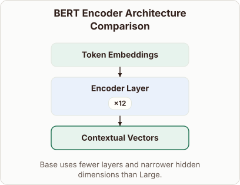
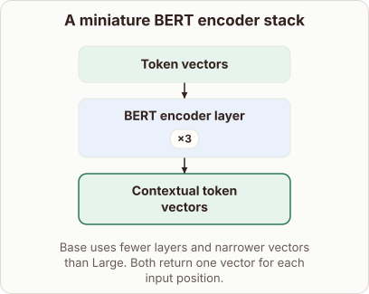

# Differences Between BERT Base and BERT Large

- Prompt (reference.prompts[0]): What changes between BERT Base and BERT Large?
- Reference id: ml-bert-encoder-depth (source: BERT)
- Intended kind (reference.spec.diagram.kind): block-stack
- Planner kind: block-stack (reference override; the planner said comparison) (fixed); planner routed to picture: no
- Model kind (first diagram): block-stack; all diagrams: block-stack
- Selector hit (intended reference among the references sent): yes
- References sent to the author (attempt 0): shape-block-stack, ml-bert-encoder-depth
- Structure (faithful-ref-v1, reference vs model spec): fully - The diagram is a block stack with input token vectors, a repeated encoder layer, and contextual output vectors. The repeat count is 12 instead of 3, which is an example-number difference and doesn't change the structure.
- Factual (factual-v2): 5/5, error no
- Repaired: no; visual fallback: no; authored by google / gemini-3.5-flash-lite
- Time 2563 ms; author tokens in/out 3769/480; cost US$0.002331

| model (408 px) | reference (408 px) |
|---|---|
|  |  |

## Card body (as saved)

BERT Base and BERT Large differ primarily in their structural scaling and parameter capacity.

Both models use transformer encoder blocks, but Large stacks more layers and uses wider hidden vectors to capture complex patterns.

```rh-diagram
{"version":1,"diagram":{"title":"BERT Encoder Architecture Comparison","caption":"Base uses fewer layers and narrower hidden dimensions than Large.","kind":"block-stack","blocks":[{"id":"input","label":"Token Embeddings","role":"embedding"},{"id":"layer","label":"Encoder Layer","repeat":12,"role":"attention"},{"id":"output","label":"Contextual Vectors","role":"output"}]}}
```

BERT Base uses $12$ encoder layers, a hidden dimension of $768$, and $12$ attention heads. In contrast, BERT Large scales up to $24$ layers, a hidden dimension of $1024$, and $16$ attention heads.
