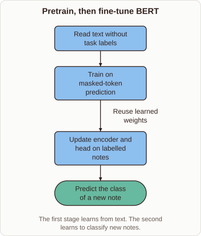
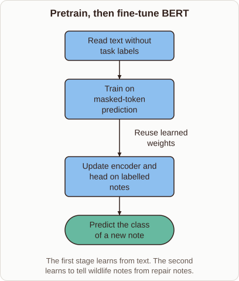

# Fine-Tuning BERT for Text Classification

- Prompt (reference.prompts[0]): What happens when you fine-tune BERT for text classification?
- Reference id: ml-bert-fine-tuning (source: BERT)
- Intended kind (reference.spec.diagram.kind): flow
- Planner kind: flow (not fixed; offered flow | layers); planner routed to picture: no
- Model kind (first diagram): flow; all diagrams: flow
- Selector hit (intended reference among the references sent): yes
- References sent to the author (attempt 0): shape-flow, ml-bert-fine-tuning, nearest-centroid-boundary
- Structure (faithful-ref-v1, reference vs model spec): fully - The diagram has the same four nodes in the same order. It has the same three edges, including the "Reuse learned weights" label. Only the caption wording differs slightly, which is an optional difference.
- Factual (factual-v2): 4/5, error no - Accurate overall. BERT pretraining uses masked-token prediction (plus next-sentence prediction in the original), so the diagram's mention of only masked-token prediction is a minor simplification. Fine-tuning updates the head and encoder together, as stated.
- Repaired: no; visual fallback: no; authored by google / gemini-3.5-flash-lite
- Time 2804 ms; author tokens in/out 4147/402; cost US$0.00225

| model (408 px) | reference (408 px) |
|---|---|
|  |  |

## Card body (as saved)

Fine-tuning adapts a pretrained model to a specific task by updating its weights on labelled data.

```rh-diagram
{"version":1,"diagram":{"title":"Pretrain, then fine-tune BERT","caption":"The first stage learns from text. The second learns to classify new notes.","kind":"flow","nodes":[{"id":"text","label":"Read text without task labels","role":"process"},{"id":"pretrain","label":"Train on masked-token prediction","role":"process"},{"id":"train","label":"Update encoder and head on labelled notes","role":"process"},{"id":"output","label":"Predict the class of a new note","role":"outcome"}],"edges":[{"from":"text","to":"pretrain"},{"from":"pretrain","to":"train","label":"Reuse learned weights"},{"from":"train","to":"output"}]}}
```

The process begins with a model that already understands general language structure from pretraining.

During fine-tuning, a task-specific classification head is added on top of the encoder.

Gradient descent then updates both the new head and the pretrained encoder parameters together.

This lets the model leverage prior knowledge while learning to solve the new classification problem.
