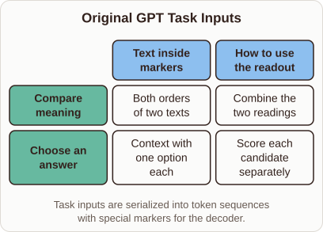
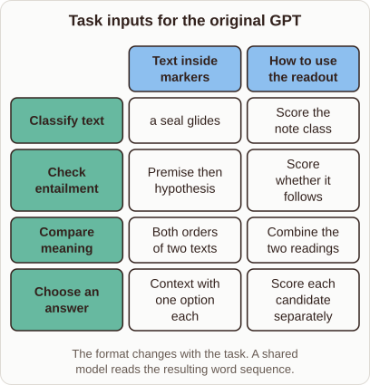

# Task Adaptation in the Original GPT

- Prompt (reference.prompts[0]): How did the original GPT adapt one model to sentence pairs and multiple-choice questions?
- Reference id: ml-bert-gpt-task-inputs (source: BERT)
- Intended kind (reference.spec.diagram.kind): matrix
- Planner kind: matrix (reference override; the planner said transformation); planner routed to picture: no
- Model kind (first diagram): matrix; all diagrams: matrix
- Selector hit (intended reference among the references sent): yes
- References sent to the author (attempt 0): shape-matrix, ml-bert-gpt-task-inputs
- Structure (faithful-ref-v1, reference vs model spec): partly - The diagram is a matrix with the right columns, but it has only 2 of the 4 reference rows (Compare meaning, Choose an answer). It is missing Classify text and Check entailment.
- Factual (factual-v2): 4/5, error no - Mostly accurate. The two-order, summed-representation approach applies to similarity tasks, not to all sentence-pair tasks (entailment uses one order). Also, the context comes first and the answer is appended to it, not the other way round.
- Repaired: no; visual fallback: no; authored by google / gemini-3.5-flash-lite
- Time 3167 ms; author tokens in/out 3810/414; cost US$0.002178

| model (408 px) | reference (408 px) |
|---|---|
|  |  |

## Card body (as saved)

The original GPT reused a single pretrained decoder across different tasks by serializing structured inputs into a continuous token sequence.

Special delimiter tokens separated parts like premises and hypotheses so the model processed them uniformly.

```rh-diagram
{"version":1,"diagram":{"title":"Original GPT Task Inputs","caption":"Task inputs are serialized into token sequences with special markers for the decoder.","kind":"matrix","columns":["Text inside markers","How to use the readout"],"rows":[{"heading":"Compare meaning","cells":["Both orders of two texts","Combine the two readings"]},{"heading":"Choose an answer","cells":["Context with one option each","Score each candidate separately"]}]}}
```

For sentence pairs, it fed both ordering permutations through the network and combined their final representations.

For multiple-choice questions, it appended the context to each candidate answer separately and scored each option independently.
