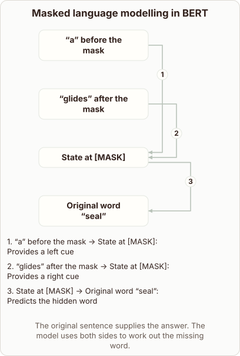

# How BERT Learns via Masked Language Modelling

- Prompt (reference.prompts[0]): How does BERT learn by filling in a masked word?
- Reference id: ml-bert-masked-token (source: BERT)
- Intended kind (reference.spec.diagram.kind): relationship
- Planner kind: relationship (reference override; the planner said token-links); planner routed to picture: no
- Model kind (first diagram): relationship; all diagrams: relationship
- Selector hit (intended reference among the references sent): yes
- References sent to the author (attempt 0): shape-relationship, ml-bert-masked-token
- Structure (faithful-ref-v1, reference vs model spec): fully - The diagram matches the reference exactly: the same four nodes, the same three labelled edges, and the same caption.
- Factual (factual-v2): 5/5, error no
- Repaired: no; visual fallback: no; authored by google / gemini-3.5-flash-lite
- Time 2569 ms; author tokens in/out 3848/513; cost US$0.002437

| model (408 px) | reference (408 px) |
|---|---|
|  |  |

## Card body (as saved)

BERT trains by hiding words in a text and guessing what was hidden. It reads left and right context simultaneously using deep bidirectional attention.

```rh-diagram
{"version":1,"diagram":{"title":"Masked language modelling in BERT","caption":"The original sentence supplies the answer. The model uses both sides to work out the missing word.","kind":"relationship","layout":"graph","nodes":[{"id":"left","label":"“a” before the mask"},{"id":"right","label":"“glides” after the mask"},{"id":"mask","label":"State at [MASK]"},{"id":"answer","label":"Original word “seal”"}],"edges":[{"from":"left","to":"mask","label":"Provides a left cue"},{"from":"right","to":"mask","label":"Provides a right cue"},{"from":"mask","to":"answer","label":"Predicts the hidden word"}]}}
```

The hidden token state gathers clues from surrounding words. The training objective compares the predicted token against the original hidden word to update weights.
