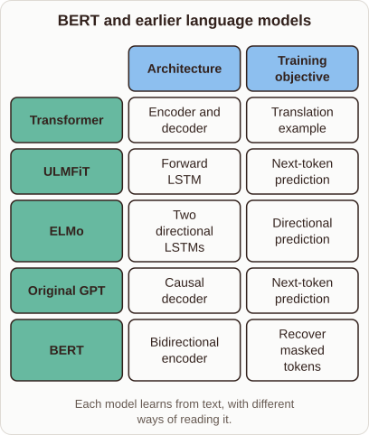

# BERT and Earlier Language Models

- Prompt (reference.prompts[0]): How did BERT build on the ideas behind the original Transformer, ELMo, and GPT?
- Reference id: ml-bert-pretraining-families (source: BERT)
- Intended kind (reference.spec.diagram.kind): matrix
- Planner kind: matrix (reference override; the planner said comparison) (fixed); planner routed to picture: no
- Model kind (first diagram): matrix; all diagrams: matrix
- Selector hit (intended reference among the references sent): yes
- References sent to the author (attempt 0): shape-matrix, ml-bert-pretraining-families
- Structure (faithful-ref-v1, reference vs model spec): fully - The diagram matches the reference matrix. It has the same title, the same five rows, the same two columns, identical cell contents and the same caption.
- Factual (factual-v2): 5/5, error no
- Repaired: yes (other: explanation_bad_diagram: the rh-diagram spec is not valid (diagram.columns.0: Invalid input: expecte); visual fallback: no; authored by google / gemini-3.5-flash-lite
- Time 5400 ms; author tokens in/out 7959/800; cost US$0.004388

| model (408 px) | reference (408 px) |
|---|---|
|  |  |

## Card body (as saved)

BERT combined the deep contextual representations pioneered by ELMo with the scalable Transformer architecture seen in GPT.

Unlike ELMo's separate directional LSTMs, BERT used a multi-layer bidirectional Transformer encoder to process text globally. This design let BERT look at both left and right context simultaneously during training.

```rh-diagram
{"version":1,"diagram":{"title":"BERT and earlier language models","caption":"Each model learns from text, with different ways of reading it.","kind":"matrix","columns":["Architecture","Training objective"],"rows":[{"heading":"Transformer","cells":["Encoder and decoder","Translation example"]},{"heading":"ULMFiT","cells":["Forward LSTM","Next-token prediction"]},{"heading":"ELMo","cells":["Two directional LSTMs","Directional prediction"]},{"heading":"Original GPT","cells":["Causal decoder","Next-token prediction"]},{"heading":"BERT","cells":["Bidirectional encoder","Recover masked tokens"]}]}}
```

Instead of predicting the next token like standard decoders, BERT adopted a masked language modeling objective to learn deep bidirectional features effectively.
