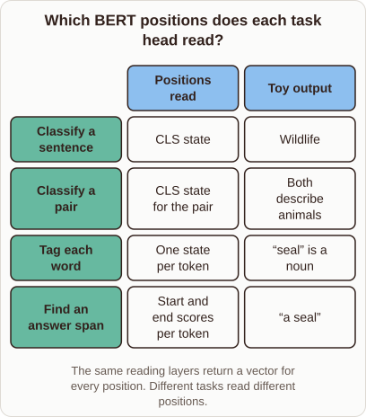

# BERT Task Heads

- Prompt (reference.prompts[0]): How does BERT use different outputs for classification, tagging, and question answering?
- Reference id: ml-bert-task-heads (source: BERT)
- Intended kind (reference.spec.diagram.kind): matrix
- Planner kind: matrix (reference override; the planner said comparison); planner routed to picture: no
- Model kind (first diagram): none; all diagrams: none
- Selector hit (intended reference among the references sent): yes
- References sent to the author (attempt 0): shape-matrix, ml-bert-task-heads, nearest-centroid-boundary
- Structure (faithful-ref-v1, reference vs model spec): none
- Factual (factual-v2): 3/5, error yes - The last sentence says heads train without modifying the lower encoder weights. Standard BERT fine-tuning updates all encoder weights together with the head. Only the feature-based approach freezes the encoder.
- Repaired: yes (other: explanation_bad_diagram: the rh-diagram spec is not valid (diagram.rows.0.id: Select layout teaching); visual fallback: "dropped"; authored by google / gemini-3.5-flash-lite
- Time 5644 ms; author tokens in/out 8571/943; cost US$0.00493

| model (408 px) | reference (408 px) |
|---|---|
|  |  |

## Card body (as saved)

BERT keeps its pretrained encoder architecture fixed and changes only the readout layer for each downstream task.

Sentence classification reads the special classification token state, which aggregates global context across the entire input sequence.

Token tagging reads every position's hidden vector independently to assign a label to each individual word.

Question answering evaluates start and end score vectors across all token positions to extract an exact text span.

Task-specific heads train on top of these shared contextual representations without modifying the lower encoder weights.
