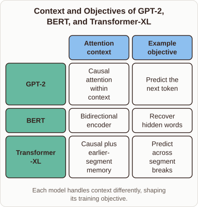
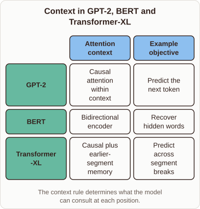

# Comparing Architectures: GPT-2, BERT, and Transformer-XL

- Prompt (reference.prompts[0]): What is the difference between GPT-2, BERT, and Transformer-XL?
- Reference id: ml-gpt2-context-architecture (source: GPT-2)
- Intended kind (reference.spec.diagram.kind): matrix
- Planner kind: matrix (reference override; the planner said comparison) (fixed); planner routed to picture: no
- Model kind (first diagram): matrix; all diagrams: matrix
- Selector hit (intended reference among the references sent): yes
- References sent to the author (attempt 0): shape-matrix, ml-gpt2-context-architecture
- Structure (faithful-ref-v1, reference vs model spec): fully - The diagram is a matrix with the same three model rows and the same two columns. Every cell matches the reference. Only the title and caption wording differ, and that is optional.
- Factual (factual-v2): 5/5, error no
- Repaired: yes (other: explanation_bad_diagram: the rh-diagram spec is not valid (diagram.rows.0.id: Select layout teaching); visual fallback: no; authored by google / gemini-3.5-flash-lite
- Time 5958 ms; author tokens in/out 8024/1119; cost US$0.005206

| model (408 px) | reference (408 px) |
|---|---|
|  |  |

## Card body (as saved)

Language models process text using distinct attention mechanisms that define how they understand context. GPT-2 uses a causal mask, meaning it only looks backward at previous tokens to predict the next word.

```rh-diagram
{"version":1,"diagram":{"title":"Context and Objectives of GPT-2, BERT, and Transformer-XL","caption":"Each model handles context differently, shaping its training objective.","kind":"matrix","columns":["Attention context","Example objective"],"rows":[{"heading":"GPT-2","cells":["Causal attention within context","Predict the next token"]},{"heading":"BERT","cells":["Bidirectional encoder","Recover hidden words"]},{"heading":"Transformer-XL","cells":["Causal plus earlier-segment memory","Predict across segment breaks"]}]}}
```

BERT reads text bidirectionally, allowing tokens to attend to both left and right contexts simultaneously. This makes it ideal for tasks like fill-in-the-blank recovery but restricts direct generation.

Transformer-XL introduces memory segments to extend context beyond fixed windows. It caches past activations, enabling models to retain dependencies across long boundaries.
