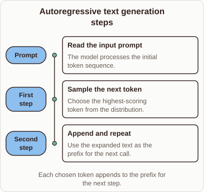
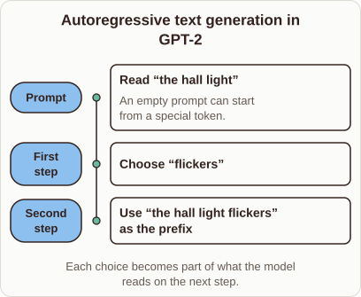

# Autoregressive text generation in GPT-2

- Prompt (reference.prompts[0]): How does GPT-2 generate text one token at a time?
- Reference id: ml-gpt2-continue-prefix (source: GPT-2)
- Intended kind (reference.spec.diagram.kind): timeline
- Planner kind: timeline (reference override; the planner said cycle); planner routed to picture: no
- Model kind (first diagram): timeline; all diagrams: timeline
- Selector hit (intended reference among the references sent): yes
- References sent to the author (attempt 0): shape-timeline, ml-gpt2-continue-prefix
- Structure (faithful-ref-v1, reference vs model spec): fully - The diagram is a timeline with the same three stages: prompt, first step (choose a token), second step (the expanded text becomes the prefix). It has the same caption idea. It uses generic wording instead of the example text, which is an optional difference.
- Factual (factual-v2): 3/5, error yes - Diagram calls the step 'sample' but describes choosing the highest-scoring token, which is greedy decoding, not sampling; the prose says sampling, so the two conflict.
- Repaired: no; visual fallback: no; authored by google / gemini-3.5-flash-lite
- Time 2497 ms; author tokens in/out 3787/423; cost US$0.002194

| model (408 px) | reference (408 px) |
|---|---|
|  |  |

## Card body (as saved)

GPT-2 generates text autoregressively by predicting one token at a time, feeding its own previous outputs back into its input context.

```rh-diagram
{"version":1,"diagram":{"title":"Autoregressive text generation steps","caption":"Each chosen token appends to the prefix for the next step.","kind":"timeline","events":[{"time":"Prompt","label":"Read the input prompt","detail":"The model processes the initial token sequence."},{"time":"First step","label":"Sample the next token","detail":"Choose the highest-scoring token from the distribution."},{"time":"Second step","label":"Append and repeat","detail":"Use the expanded text as the prefix for the next call."}]}}
```

When given a text prompt, the model computes probability distributions over its vocabulary and samples the next token. This new token appends to the existing prefix, and the cycle repeats until an end token appears.
