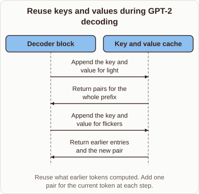
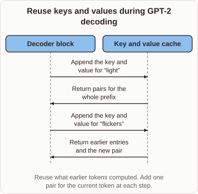

# KV Cache Reuse in GPT-2 Generation

- Prompt (reference.prompts[0]): How does the KV cache help GPT-2 reuse work while generating?
- Reference id: ml-gpt2-decode-cache (source: GPT-2)
- Intended kind (reference.spec.diagram.kind): sequence
- Planner kind: sequence (reference override; the planner said token-links); planner routed to picture: no
- Model kind (first diagram): sequence; all diagrams: sequence
- Selector hit (intended reference among the references sent): yes
- References sent to the author (attempt 0): shape-sequence, ml-gpt2-decode-cache
- Structure (faithful-ref-v1, reference vs model spec): fully - The diagram matches the reference. It has the same two actors and the same four messages in the same order and direction. The only difference is that the quotation marks around the words are missing.
- Factual (factual-v2): 4/5, error no - First sentence describes the no-cache baseline without saying so, and 'instantly' is loose; otherwise accurate.
- Repaired: no; visual fallback: no; authored by google / gemini-3.5-flash-lite
- Time 2670 ms; author tokens in/out 3878/572; cost US$0.002594

| model (408 px) | reference (408 px) |
|---|---|
|  |  |

## Card body (as saved)

When generating text token by token, an autoregressive model like GPT-2 computes keys and values for every prior token at each step.

```rh-diagram
{"version":1,"diagram":{"title":"Reuse keys and values during GPT-2 decoding","caption":"Reuse what earlier tokens computed. Add one pair for the current token at each step.","kind":"sequence","actors":[{"id":"block","label":"Decoder block"},{"id":"cache","label":"Key and value cache"}],"messages":[{"from":"block","to":"cache","label":"Append the key and value for light"},{"from":"cache","to":"block","label":"Return pairs for the whole prefix"},{"from":"block","to":"cache","label":"Append the key and value for flickers"},{"from":"cache","to":"block","label":"Return earlier entries and the new pair"}]}}
```

The KV cache stores these previously computed vectors so the model avoids redundant recalculations.

Instead of reprocessing the entire sequence, the decoder appends only the new token's projections and retrieves the full history instantly.
