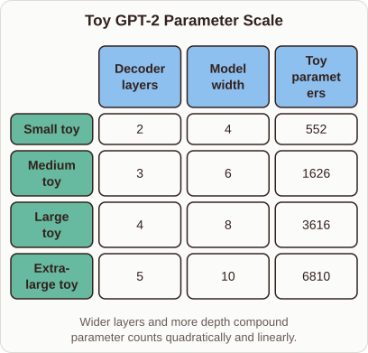
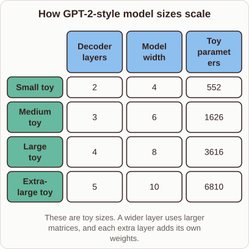

# Why GPT-2 Sizes Differ in Parameters

- Prompt (reference.prompts[0]): Why do the different GPT-2 sizes have such different parameter counts?
- Reference id: ml-gpt2-parameter-counts (source: GPT-2)
- Intended kind (reference.spec.diagram.kind): matrix
- Planner kind: matrix (reference override; the planner said comparison); planner routed to picture: no
- Model kind (first diagram): matrix; all diagrams: matrix
- Selector hit (intended reference among the references sent): yes
- References sent to the author (attempt 0): shape-matrix, ml-gpt2-parameter-counts
- Structure (faithful-ref-v1, reference vs model spec): fully - The diagram has the same matrix structure as the reference. It has four rows (Small, Medium, Large and Extra-large toy) and three columns (layers, width, parameters). Every cell value matches. Only the title and caption wording differ, and those are optional.
- Factual (factual-v2): 5/5, error no - The toy parameter counts match GPT-2's formula (12d²+13d per layer, plus embeddings and the final layer norm, with vocabulary 10 and context 4). Width scales weights quadratically and depth scales them linearly, as the prose says.
- Repaired: no; visual fallback: no; authored by google / gemini-3.5-flash-lite
- Time 3102 ms; author tokens in/out 3808/507; cost US$0.00241

| model (408 px) | reference (408 px) |
|---|---|
|  |  |

## Card body (as saved)

Language models scale their parameter counts through the dimensions of their hidden states and the count of stacked transformer layers.

When a model becomes wider, the attention projection matrices and feed-forward hidden dimensions grow, increasing weights quadratically.

```rh-diagram
{"version":1,"diagram":{"title":"Toy GPT-2 Parameter Scale","caption":"Wider layers and more depth compound parameter counts quadratically and linearly.","kind":"matrix","columns":["Decoder layers","Model width","Toy parameters"],"rows":[{"heading":"Small toy","cells":["2","4","552"]},{"heading":"Medium toy","cells":["3","6","1626"]},{"heading":"Large toy","cells":["4","8","3616"]},{"heading":"Extra-large toy","cells":["5","10","6810"]}]}}
```

Adding more decoder layers compounds this growth linearly because each layer introduces independent sets of attention and MLP weights. These structural choices dictate the memory footprint and capacity of the network.
