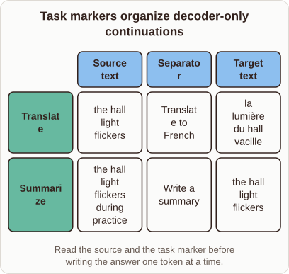

# Task Markers in Decoder-Only Models

- Prompt (reference.prompts[0]): How can GPT-2 use a task marker to translate or summarize text?
- Reference id: ml-gpt2-task-separators (source: GPT-2)
- Intended kind (reference.spec.diagram.kind): matrix
- Planner kind: matrix (reference override; the planner said transformation) (fixed); planner routed to picture: no
- Model kind (first diagram): matrix; all diagrams: matrix
- Selector hit (intended reference among the references sent): yes
- References sent to the author (attempt 0): shape-matrix, ml-gpt2-task-separators
- Structure (faithful-ref-v1, reference vs model spec): fully - The diagram matches the reference exactly. It is a matrix with the same title, the same three columns, and both rows (Translate and Summarize) with identical cell contents and caption.
- Factual (factual-v2): 5/5, error no
- Repaired: no; visual fallback: no; authored by google / gemini-3.5-flash-lite
- Time 2856 ms; author tokens in/out 3791/490; cost US$0.002363

| model (408 px) | reference (408 px) |
|---|---|
|  |  |

## Card body (as saved)

Decoder-only models process inputs as a single continuous sequence of tokens.

By inserting a specific task marker between the source text and the desired output, the model shifts its attention context to perform the requested operation without changing its weights.

```rh-diagram
{"version":1,"diagram":{"title":"Task markers organize decoder-only continuations","caption":"Read the source and the task marker before writing the answer one token at a time.","kind":"matrix","columns":["Source text","Separator","Target text"],"rows":[{"heading":"Translate","cells":["the hall light flickers","Translate to French","la lumière du hall vacille"]},{"heading":"Summarize","cells":["the hall light flickers during practice","Write a summary","the hall light flickers"]}]}}
```

This conditioning lets a single autoregressive network handle multiple distinct tasks.

The tokens in the task marker act as a prompt prefix that steers the probability distribution of subsequent generated tokens toward the correct output domain.
