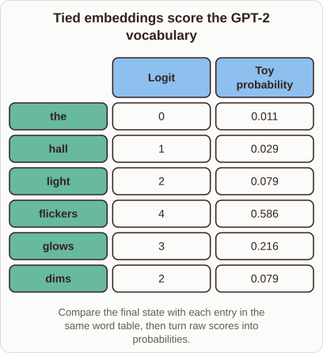
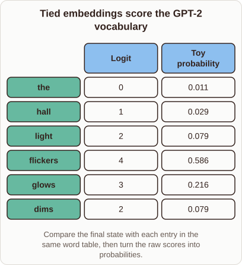

# Why GPT-2 Ties Token Embeddings and Output Weights

- Prompt (reference.prompts[0]): Why does GPT-2 reuse the token embedding weights for its output layer?
- Reference id: ml-gpt2-tied-output-weights (source: GPT-2)
- Intended kind (reference.spec.diagram.kind): matrix
- Planner kind: matrix (reference override; the planner said layers); planner routed to picture: no
- Model kind (first diagram): matrix; all diagrams: matrix
- Selector hit (intended reference among the references sent): yes
- References sent to the author (attempt 0): shape-matrix, ml-gpt2-tied-output-weights, general-layers-2
- Structure (faithful-ref-v1, reference vs model spec): fully - The diagram matches the reference matrix: same title, the same six word rows with identical logits and probabilities, and the same two columns. The caption differs only by a dropped "the".
- Factual (factual-v2): 3/5, error yes - The claim that tying 'prevents severe overfitting on smaller text corpora' is an overclaim. GPT-2 was trained on the large WebText corpus, and tying is mainly a parameter-saving and regularizing choice. The tying itself, the tens-of-millions parameter saving (about 38M for the small model) and the toy softmax values are correct.
- Repaired: no; visual fallback: no; authored by google / gemini-3.5-flash-lite
- Time 3297 ms; author tokens in/out 3923/642; cost US$0.002782

| model (408 px) | reference (408 px) |
|---|---|
|  |  |

## Card body (as saved)

GPT-2 reuses its input token embedding weights in the final output layer to save parameters and stabilize training.

Instead of learning a separate projection matrix for every vocabulary token, it takes the dot product of the final hidden state with the same vectors that turn input tokens into vectors.

```rh-diagram
{"version":1,"diagram":{"title":"Tied embeddings score the GPT-2 vocabulary","caption":"Compare the final state with each entry in the same word table, then turn raw scores into probabilities.","kind":"matrix","columns":["Logit","Toy probability"],"rows":[{"heading":"the","cells":["0","0.011"]},{"heading":"hall","cells":["1","0.029"]},{"heading":"light","cells":["2","0.079"]},{"heading":"flickers","cells":["4","0.586"]},{"heading":"glows","cells":["3","0.216"]},{"heading":"dims","cells":["2","0.079"]}]}}
```

This weight tying reduces model size by tens of millions of parameters, preventing severe overfitting on smaller text corpora.

Because the input embedding space and output logit space share the same geometric orientation, token representations remain tightly aligned throughout optimization.
