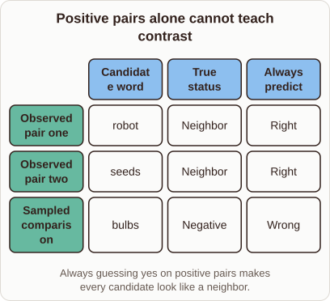
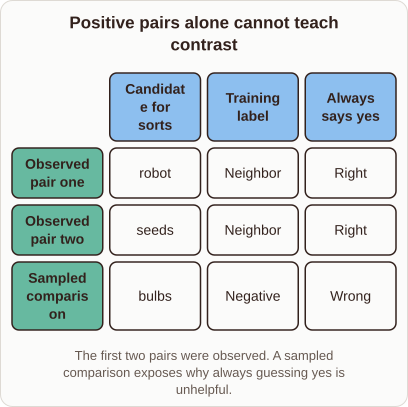

# Why Word2vec Needs Negative Examples

- Prompt (reference.prompts[0]): Why does Word2vec need negative examples when all observed pairs are neighbors?
- Reference id: ml-word2vec-positive-only-failure (source: Word2vec)
- Intended kind (reference.spec.diagram.kind): matrix
- Planner kind: matrix (reference override; the planner said coordinate-plot); planner routed to picture: no
- Model kind (first diagram): matrix; all diagrams: matrix
- Selector hit (intended reference among the references sent): yes
- References sent to the author (attempt 0): shape-matrix, ml-word2vec-positive-only-failure, knn-neighbourhood
- Structure (faithful-ref-v1, reference vs model spec): fully - The diagram is a matrix with the same three rows (two observed pairs and one sampled comparison) and the same three columns. The cell values match: robot, seeds and bulbs; Neighbor, Neighbor and Negative; Right, Right and Wrong. The column headers and caption are reworded, which is an optional difference.
- Factual (factual-v2): 5/5, error no
- Repaired: no; visual fallback: no; authored by google / gemini-3.5-flash-lite
- Time 3026 ms; author tokens in/out 4030/495; cost US$0.002447

| model (408 px) | reference (408 px) |
|---|---|
|  |  |

## Card body (as saved)

Word2vec learns by predicting whether two words appear close together in text.

If we only feed it observed neighbor pairs, the model quickly learns a trivial solution: always assign a high probability to every candidate pair. It never learns to push unrelated words apart in vector space.

```rh-diagram
{"version":1,"diagram":{"title":"Positive pairs alone cannot teach contrast","caption":"Always guessing yes on positive pairs makes every candidate look like a neighbor.","kind":"matrix","columns":["Candidate word","True status","Always predict"],"rows":[{"heading":"Observed pair one","cells":["robot","Neighbor","Right"]},{"heading":"Observed pair two","cells":["seeds","Neighbor","Right"]},{"heading":"Sampled comparison","cells":["bulbs","Negative","Wrong"]}]}}
```

Adding negative examples forces the model to discriminate between actual context words and random vocabulary terms.

By penalizing high probabilities for unobserved pairs, the objective function creates meaningful geometric distances where similar words cluster and unrelated words separate.
