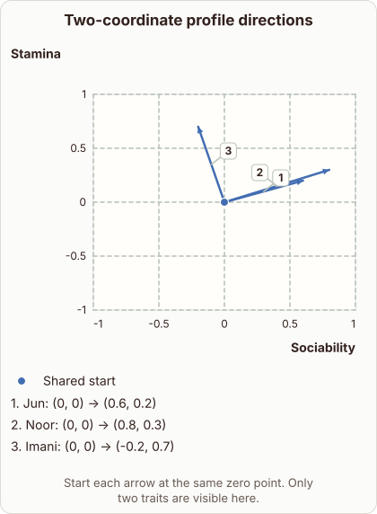

# Profile Vector Direction on Two Axes

- Prompt (reference.prompts[0]): How can I see the direction of a profile vector on two axes?
- Reference id: ml-word2vec-profile-directions (source: Word2vec)
- Intended kind (reference.spec.diagram.kind): coordinate-plot
- Planner kind: coordinate-plot (fixed); planner routed to picture: no
- Model kind (first diagram): coordinate-plot; all diagrams: coordinate-plot
- Selector hit (intended reference among the references sent): yes
- References sent to the author (attempt 0): shape-coordinate-plot, ml-word2vec-profile-directions, cosine-vector-directions
- Structure (faithful-ref-v1, reference vs model spec): fully - The diagram's description matches the reference exactly. It has the same axes, the shared origin point, and the three arrows (Jun, Noor, Imani) with identical endpoints.
- Factual (factual-v2): 5/5, error no
- Repaired: no; visual fallback: no; authored by google / gemini-3.5-flash-lite
- Time 3391 ms; author tokens in/out 4170/749; cost US$0.003124

| model (408 px) | reference (408 px) |
|---|---|
|  |  |

## Card body (as saved)

To see the direction of a profile vector on two axes, you plot each trait value as a coordinate pair $(x, y)$. The vector is then drawn as an arrow starting from the origin $(0,0)$ and ending at that coordinate point.

This geometric representation lets you compare how different profiles point across the two specified traits.

```rh-diagram
{"version":1,"diagram":{"title":"Two-coordinate profile directions","caption":"Start each arrow at the same zero point. Only two traits are visible here.","kind":"coordinate-plot","x":{"label":"Sociability","min":-1,"max":1},"y":{"label":"Stamina","min":-1,"max":1},"series":[{"label":"Shared start","kind":"scatter","points":[{"x":0,"y":0}]}],"annotations":[{"kind":"vector","label":"Jun","from":{"x":0,"y":0},"to":{"x":0.6,"y":0.2}},{"kind":"vector","label":"Noor","from":{"x":0,"y":0},"to":{"x":0.8,"y":0.3}},{"kind":"vector","label":"Imani","from":{"x":0,"y":0},"to":{"x":-0.2,"y":0.7}}]}}
```

When multiple vectors share the same origin, the angle between their arrows shows how similar their trait balances are.

A smaller angle means the profiles point in a more similar direction, regardless of the vector lengths.
