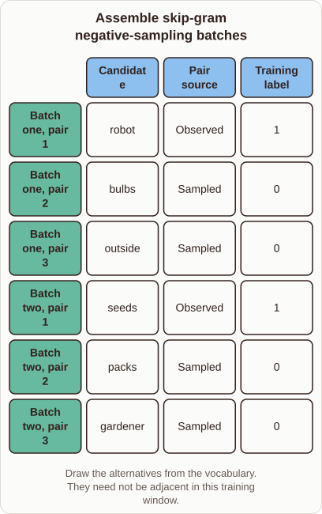

# Making Negative Sampling Training Rows

- Prompt (reference.prompts[0]): How does negative sampling make the actual training rows for Word2vec?
- Reference id: ml-word2vec-sampled-training-rows (source: Word2vec)
- Intended kind (reference.spec.diagram.kind): matrix
- Planner kind: matrix (reference override; the planner said sample-set); planner routed to picture: no
- Model kind (first diagram): matrix; all diagrams: matrix
- Selector hit (intended reference among the references sent): yes
- References sent to the author (attempt 0): shape-matrix, ml-word2vec-sampled-training-rows, ml-feature-store-architecture
- Structure (faithful-ref-v1, reference vs model spec): fully - The diagram's rows, columns, cell values and caption are identical to the reference matrix.
- Factual (factual-v2): 5/5, error no
- Repaired: no; visual fallback: no; authored by google / gemini-3.5-flash-lite
- Time 3390 ms; author tokens in/out 4027/559; cost US$0.002606

| model (408 px) | reference (408 px) |
|---|---|
|  |  |

## Card body (as saved)

Negative sampling turns the impossible task of updating every vocabulary word into a binary classification problem for each observed context word.

For each true word pair, the model keeps one positive example with a label of $1$.

```rh-diagram
{"version":1,"diagram":{"title":"Assemble skip-gram negative-sampling batches","caption":"Draw the alternatives from the vocabulary. They need not be adjacent in this training window.","kind":"matrix","columns":["Candidate","Pair source","Training label"],"rows":[{"heading":"Batch one, pair 1","cells":["robot","Observed","1"]},{"heading":"Batch one, pair 2","cells":["bulbs","Sampled","0"]},{"heading":"Batch one, pair 3","cells":["outside","Sampled","0"]},{"heading":"Batch two, pair 1","cells":["seeds","Observed","1"]},{"heading":"Batch two, pair 2","cells":["packs","Sampled","0"]},{"heading":"Batch two, pair 3","cells":["gardener","Sampled","0"]}]}}
```

It then draws a few random noise words from the vocabulary as negative examples with labels of $0$. This setup updates only a tiny fraction of the weights per step, speeding up training enormously.
