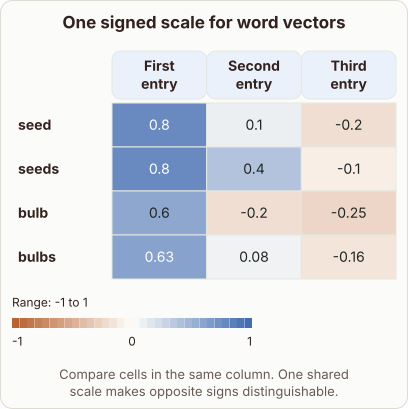

# Reading Word2vec Embedding Heatmaps

- Prompt (reference.prompts[0]): How do I read the colored cells of a Word2vec embedding heatmap?
- Reference id: ml-word2vec-signed-embedding-heatmap (source: Word2vec)
- Intended kind (reference.spec.diagram.kind): heatmap
- Planner kind: heatmap (fixed); planner routed to picture: no
- Model kind (first diagram): heatmap; all diagrams: heatmap
- Selector hit (intended reference among the references sent): yes
- References sent to the author (attempt 0): ml-word2vec-signed-embedding-heatmap
- Structure (faithful-ref-v1, reference vs model spec): fully - The diagram matches the reference exactly. It is a heatmap with the same four rows, the same three columns, the same cell values and the same -1 to 1 range.
- Factual (factual-v2): 3/5, error yes - Reading across columns compares dimensions within one word's row. Comparing related words means reading down a column, as the diagram itself says, so the prose contradicts it.
- Repaired: no; visual fallback: no; authored by google / gemini-3.5-flash-lite
- Time 2753 ms; author tokens in/out 3759/463; cost US$0.002286

| model (408 px) | reference (408 px) |
|---|---|
|  |  |

## Card body (as saved)

Word2vec heatmaps display numerical vector components as colored grid cells. Each row represents a specific word token, while each column corresponds to a vector dimension index.

```rh-diagram
{"version":1,"diagram":{"title":"One signed scale for word vectors","caption":"Compare cells in the same column. One shared scale makes opposite signs distinguishable.","kind":"heatmap","columns":["First entry","Second entry","Third entry"],"rows":[{"label":"seed","cells":[0.8,0.1,-0.2]},{"label":"seeds","cells":[0.8,0.4,-0.1]},{"label":"bulb","cells":[0.6,-0.2,-0.25]},{"label":"bulbs","cells":[0.63,0.08,-0.16]}],"range":{"min":-1,"max":1}}}
```

Positive values receive warm colors, whereas negative values receive cool colors. Reading across columns allows you to compare component magnitudes directly across related words.
