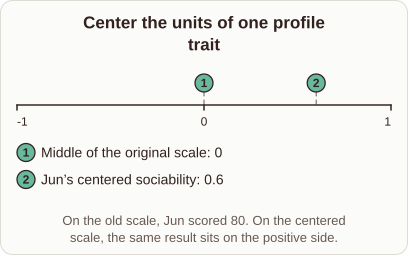

# Rescaling Personality Scores in Embedding Coordinates

- Prompt (reference.prompts[0]): How does rescaling a personality score help explain embedding coordinates?
- Reference id: ml-word2vec-trait-rescale (source: Word2vec)
- Intended kind (reference.spec.diagram.kind): number-line
- Planner kind: number-line (reference override; the planner said transformation); planner routed to picture: no
- Model kind (first diagram): number-line; all diagrams: number-line
- Selector hit (intended reference among the references sent): yes
- References sent to the author (attempt 0): shape-number-line, ml-word2vec-trait-rescale
- Structure (faithful-ref-v1, reference vs model spec): fully - The diagram is a number line from -1 to 1 with a marker at 0 (middle of the original scale) and a marker at 0.6 (Jun's centered sociability). That matches the reference in kind, range, markers and caption. The only difference is an apostrophe style.
- Factual (factual-v2): 3/5, error yes - Conflates centering (shifting) with scaling: shifting alone does not stop large-scale dimensions from dominating or give components equal contribution; that requires rescaling variance.
- Repaired: no; visual fallback: no; authored by google / gemini-3.5-flash-lite
- Time 3188 ms; author tokens in/out 3773/385; cost US$0.002095

| model (408 px) | reference (408 px) |
|---|---|
|  |  |

## Card body (as saved)

Rescaling personality scores shifts raw metrics onto a shared coordinate space by centering values around zero. This geometric alignment lets models compare distances across different psychological traits directly.

When we normalize dimensions, each vector component contributes equally to similarity measures like cosine distance.

```rh-diagram
{"version":1,"diagram":{"title":"Center the units of one profile trait","caption":"On the old scale, Jun scored 80. On the centered scale, the same result sits on the positive side.","kind":"number-line","min":-1,"max":1,"markers":[{"value":0,"label":"Middle of the original scale"},{"value":0.6,"label":"Jun's centered sociability"}]}}
```

Without this shift, large raw scales would dominate the latent space and distort the embedding geometry.
