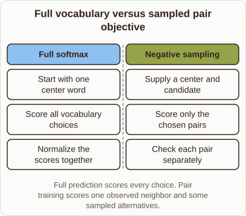

# Why Word2vec Uses Sampled Pairs Instead of Full Softmax

- Prompt (reference.prompts[0]): Why does Word2vec replace full softmax with scoring a few pairs?
- Reference id: ml-word2vec-vocabulary-versus-pair (source: Word2vec)
- Intended kind (reference.spec.diagram.kind): comparison
- Planner kind: comparison (not fixed; offered comparison | bar-chart); planner routed to picture: no
- Model kind (first diagram): comparison; all diagrams: comparison
- Selector hit (intended reference among the references sent): yes
- References sent to the author (attempt 0): shape-comparison, ml-word2vec-vocabulary-versus-pair, softmax-probabilities
- Structure (faithful-ref-v1, reference vs model spec): fully - The diagram text is identical to the reference. It is a comparison with the same title, two columns (Full softmax and Negative sampling), the same three items in each, and the same caption.
- Factual (factual-v2): 5/5, error no
- Repaired: no; visual fallback: no; authored by google / gemini-3.5-flash-lite
- Time 3828 ms; author tokens in/out 3906/475; cost US$0.00236

| model (408 px) | reference (408 px) |
|---|---|
|  |  |

## Card body (as saved)

Calculating a full softmax over millions of words requires summing scores across the entire vocabulary for every single training step.

```rh-diagram
{"version":1,"diagram":{"title":"Full vocabulary versus sampled pair objective","caption":"Full prediction scores every choice. Pair training scores one observed neighbor and some sampled alternatives.","kind":"comparison","columns":[{"heading":"Full softmax","items":["Start with one center word","Score all vocabulary choices","Normalize the scores together"]},{"heading":"Negative sampling","items":["Supply a center and candidate","Score only the chosen pairs","Check each pair separately"]}]}}
```

This computation becomes extremely slow when vocabulary sizes grow large. Negative sampling avoids this bottleneck by evaluating only the correct target word alongside a few random negative samples.

By treating the problem as a set of independent binary classification tasks rather than a multi-class distribution, training speeds up dramatically.
