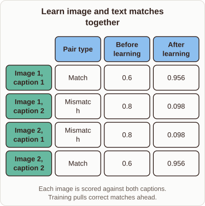
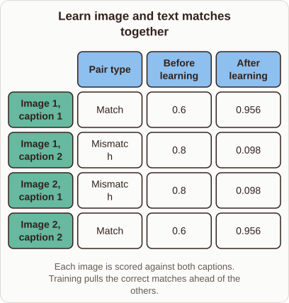

# CLIP Contrastive Training

- Prompt (reference.prompts[0]): How does CLIP training make matching image and text embeddings more similar?
- Reference id: ml-stable-diffusion-clip-contrastive-scores (source: Stable Diffusion)
- Intended kind (reference.spec.diagram.kind): matrix
- Planner kind: matrix (reference override; the planner said flow); planner routed to picture: no
- Model kind (first diagram): matrix; all diagrams: matrix
- Selector hit (intended reference among the references sent): yes
- References sent to the author (attempt 0): shape-matrix, ml-stable-diffusion-clip-contrastive-scores, ml-feature-store-architecture
- Structure (faithful-ref-v1, reference vs model spec): fully - The diagram has the same matrix structure as the reference. It has the same four rows, the same Pair type, Before learning and After learning columns, and identical values. Only the caption is shortened.
- Factual (factual-v2): 5/5, error no
- Repaired: no; visual fallback: no; authored by google / gemini-3.5-flash-lite
- Time 3273 ms; author tokens in/out 4014/558; cost US$0.0026

| model (408 px) | reference (408 px) |
|---|---|
|  |  |

## Card body (as saved)

CLIP trains image and text encoders simultaneously to align their vector spaces. It computes cosine similarities between all image-text pairs in a batch.

```rh-diagram
{"version":1,"diagram":{"title":"Learn image and text matches together","caption":"Each image is scored against both captions. Training pulls correct matches ahead.","kind":"matrix","columns":["Pair type","Before learning","After learning"],"rows":[{"heading":"Image 1, caption 1","cells":["Match","0.6","0.956"]},{"heading":"Image 1, caption 2","cells":["Mismatch","0.8","0.098"]},{"heading":"Image 2, caption 1","cells":["Mismatch","0.8","0.098"]},{"heading":"Image 2, caption 2","cells":["Match","0.6","0.956"]}]}}
```

The model maximizes similarity for correct pairs while minimizing it for incorrect ones. This contrastive objective updates weights so matching embeddings grow close.
