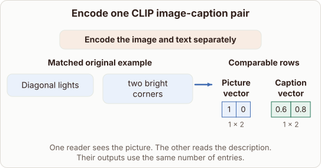

# CLIP Dual Encoders

- Prompt (reference.prompts[0]): Why does CLIP have separate encoders for the picture and caption?
- Reference id: ml-stable-diffusion-clip-two-encoders (source: Stable Diffusion)
- Intended kind (reference.spec.diagram.kind): transformation
- Planner kind: transformation (reference override; the planner said block-stack); planner routed to picture: no
- Model kind (first diagram): picture; all diagrams: none
- Selector hit (intended reference among the references sent): yes
- References sent to the author (attempt 0): shape-transformation, ml-stable-diffusion-clip-two-encoders
- Structure (faithful-ref-v1, reference vs model spec): none
- Factual (factual-v2): 5/5, error no
- Repaired: no; visual fallback: no; authored by google / gemini-3.5-flash-lite
- Time 5210 ms; author tokens in/out 3930/253; cost US$0.008812

| model (408 px) | reference (408 px) |
|---|---|
|  |  |

## Card body (as saved)

CLIP uses separate encoders because pictures and text have completely different raw formats and native statistical properties.

Pixels form a continuous two-dimensional grid, whereas text consists of discrete tokens drawn from a finite vocabulary.

```rh-illustration
{"version":1,"id":"pic-1","prompt":"An image and a block of text entering two distinct deep neural network pathways side by side to align in a shared vector space","alt":"An image encoder and a text encoder processing inputs separately","caption":"Two separate pathways map different inputs into a shared space."}
```

Passing each modality through its own dedicated network lets each encoder learn specialized feature representations.

Once processed, both networks project their outputs into a shared embedding space where semantic similarity can be measured directly by dot products.
