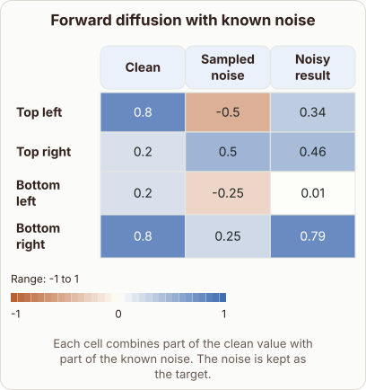

# Forward Diffusion Noise Addition

- Prompt (reference.prompts[0]): Can you show the numbers when forward diffusion adds known noise to a latent?
- Reference id: ml-stable-diffusion-forward-noise (source: Stable Diffusion)
- Intended kind (reference.spec.diagram.kind): heatmap
- Planner kind: heatmap (reference override; the planner said transformation); planner routed to picture: no
- Model kind (first diagram): none; all diagrams: none
- Selector hit (intended reference among the references sent): yes
- References sent to the author (attempt 0): ml-stable-diffusion-forward-noise
- Structure (faithful-ref-v1, reference vs model spec): none
- Factual (factual-v2): 4/5, error no - Accurate overall: forward diffusion mixes the clean signal with Gaussian noise, with the signal coefficient sqrt(alpha_bar_t) shrinking and the noise coefficient sqrt(1-alpha_bar_t) growing. The 'latent' framing fits latent diffusion. It is slightly simplified, since the training target is typically the noise or the clean signal.
- Repaired: yes (other: explanation_bad_diagram: the rh-diagram spec is not valid (diagram.columns.0: Invalid input: expecte); visual fallback: "dropped"; authored by google / gemini-3.5-flash-lite
- Time 5478 ms; author tokens in/out 7857/854; cost US$0.004493

| model (408 px) | reference (408 px) |
|---|---|
|  |  |

## Card body (as saved)

Forward diffusion corrupts a clean latent by mixing it with sampled Gaussian noise over discrete steps. Each latent cell receives a weighted sum of the original signal and the perturbation.

As the step increases, the clean coefficient shrinks while the noise coefficient grows. This gradual corruption creates the training targets for the denoising network.
