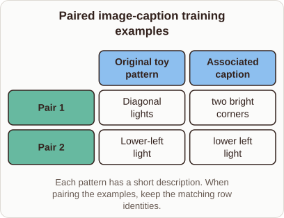

# (no card delivered)

- Prompt (reference.prompts[0]): What does an image and caption pair look like in CLIP training data?
- Reference id: ml-stable-diffusion-image-caption-pairs (source: Stable Diffusion)
- Intended kind (reference.spec.diagram.kind): matrix
- Planner kind: matrix (reference override; the planner said sample-set) (fixed); planner routed to picture: no
- Model kind (first diagram): FAILED; all diagrams: none
- Selector hit (intended reference among the references sent): yes
- References sent to the author (attempt 0): shape-matrix, ml-stable-diffusion-image-caption-pairs, ml-feature-store-architecture
- Structure (faithful-ref-v1, reference vs model spec): none
- Factual (factual-v2): not judged
- Repaired: yes (other: explanation_bad_diagram: the rh-diagram spec is not valid (diagram.columns.0: Invalid input: expecte, visual marker / layout, visual marker / layout, visual marker / layout); visual fallback: no; authored by - / -
- Time 16793 ms; author tokens in/out 30133/1646; cost US$0.022254

| model (408 px) | reference (408 px) |
|---|---|
|  |  |

## Card body (as saved)

