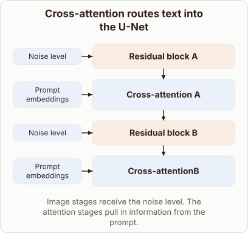

# Text Embeddings in the Stable Diffusion U-Net

- Prompt (reference.prompts[0]): Where do text prompt embeddings go inside the Stable Diffusion U-Net?
- Reference id: ml-stable-diffusion-unet-text-attention (source: Stable Diffusion)
- Intended kind (reference.spec.diagram.kind): block-stack
- Planner kind: block-stack (fixed); planner routed to picture: no
- Model kind (first diagram): block-stack; all diagrams: block-stack
- Selector hit (intended reference among the references sent): yes
- References sent to the author (attempt 0): shape-block-stack, ml-stable-diffusion-unet-text-attention
- Structure (faithful-ref-v1, reference vs model spec): fully - The diagram has the same block-stack structure as the reference. The four blocks run in the same order. Noise level feeds both residual blocks and prompt embeddings feed both cross-attention blocks. The only difference is a label typo ("Cross-attentionB"), which is cosmetic.
- Factual (factual-v2): 4/5, error no - Minor simplification: 'every resolution scale' is not strictly true, since SD's highest-resolution down-block stage (in SD 1.x, the lowest-resolution down block and highest-resolution up block) lacks attention.
- Repaired: no; visual fallback: no; authored by google / gemini-3.5-flash-lite
- Time 3298 ms; author tokens in/out 3829/613; cost US$0.002682

| model (408 px) | reference (408 px) |
|---|---|
|  |  |

## Card body (as saved)

Text prompt embeddings enter the Stable Diffusion U-Net through specialized cross-attention blocks placed between standard residual layers.

These attention blocks allow the spatial image features to query the text token representations directly.

```rh-diagram
{"version":1,"diagram":{"title":"Cross-attention routes text into the U-Net","caption":"Image stages receive the noise level. The attention stages pull in information from the prompt.","kind":"block-stack","blocks":[{"id":"b0","label":"Residual block A","role":"feedforward","inputs":[{"label":"Noise level"}]},{"id":"b1","label":"Cross-attention A","role":"attention","inputs":[{"label":"Prompt embeddings"}]},{"id":"b2","label":"Residual block B","role":"feedforward","inputs":[{"label":"Noise level"}]},{"id":"b3","label":"Cross-attentionB","role":"attention","inputs":[{"label":"Prompt embeddings"}]}]}}
```

Inside each cross-attention layer, image features supply the query vectors while the text prompt embeddings provide the keys and values.

This mechanism steers the denoising process to match the user prompt at every resolution scale.
