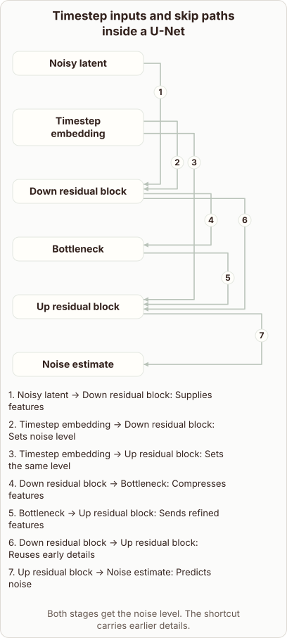

# Timestep Embeddings and Skip Connections in the U-Net

- Prompt (reference.prompts[0]): How do timestep embeddings and skip connections enter the Stable Diffusion U-Net?
- Reference id: ml-stable-diffusion-unet-timestep-and-skips (source: Stable Diffusion)
- Intended kind (reference.spec.diagram.kind): relationship
- Planner kind: relationship (reference override; the planner said block-stack) (fixed); planner routed to picture: no
- Model kind (first diagram): relationship; all diagrams: relationship
- Selector hit (intended reference among the references sent): yes
- References sent to the author (attempt 0): shape-relationship, ml-stable-diffusion-unet-timestep-and-skips
- Structure (faithful-ref-v1, reference vs model spec): fully - The diagram's nodes, edges, edge labels, title and caption all match the reference exactly.
- Factual (factual-v2): 4/5, error no - Broadly accurate: the Stable Diffusion U-Net predicts noise, timestep embeddings are injected into residual blocks, and skip connections carry encoder features to the decoder. Minor simplifications: the claim that the model would 'lose spatial structure' without these injections slightly conflates the roles (timestep embeddings give noise level, skips preserve detail), and the diagram does not show the timestep going to the bottleneck.
- Repaired: no; visual fallback: no; authored by google / gemini-3.5-flash-lite
- Time 3316 ms; author tokens in/out 3920/737; cost US$0.003019

| model (408 px) | reference (408 px) |
|---|---|
|  |  |

## Card body (as saved)

The Stable Diffusion U-Net predicts noise by passing noisy latents through contracting and expanding blocks. Timestep embeddings inject global noise-level signals into these residual blocks.

Skip connections bypass the bottleneck to preserve fine spatial details.

```rh-diagram
{"version":1,"diagram":{"title":"Timestep inputs and skip paths inside a U-Net","caption":"Both stages get the noise level. The shortcut carries earlier details.","kind":"relationship","layout":"graph","nodes":[{"id":"x","label":"Noisy latent"},{"id":"t","label":"Timestep embedding"},{"id":"down","label":"Down residual block"},{"id":"middle","label":"Bottleneck"},{"id":"up","label":"Up residual block"},{"id":"output","label":"Noise estimate"}],"edges":[{"from":"x","to":"down","label":"Supplies features"},{"from":"t","to":"down","label":"Sets noise level"},{"from":"t","to":"up","label":"Sets the same level"},{"from":"down","to":"middle","label":"Compresses features"},{"from":"middle","to":"up","label":"Sends refined features"},{"from":"down","to":"up","label":"Reuses early details"},{"from":"up","to":"output","label":"Predicts noise"}]}}
```

Both mechanisms allow the network to adjust its denoising strength across resolution scales. Without these injections, the model would lose spatial structure during downsampling.
