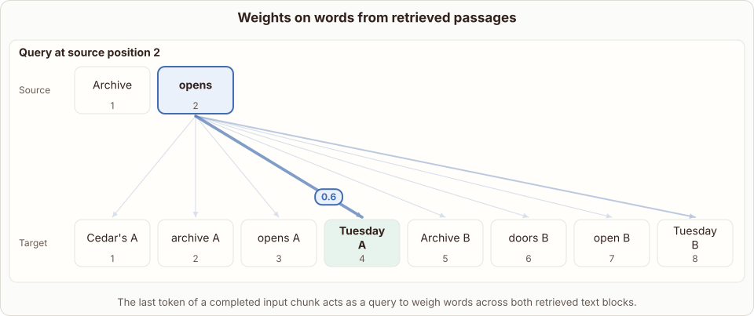
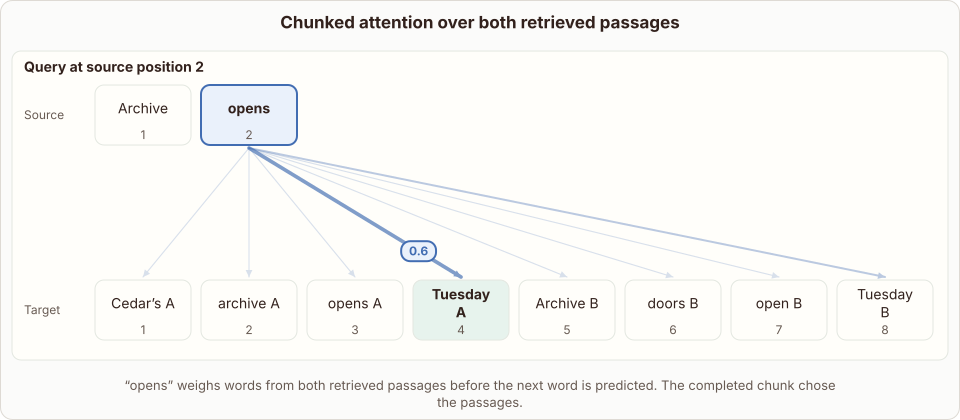

# RETRO Chunked Cross-Attention

- Prompt (reference.prompts[0]): How does RETRO chunked cross-attention choose useful words from two retrieved passages?
- Reference id: figure-retro-chunk-attention (source: Retrieval Transformer)
- Intended kind (reference.spec.diagram.kind): token-links
- Planner kind: token-links (fixed); planner routed to picture: no
- Model kind (first diagram): token-links; all diagrams: token-links
- Selector hit (intended reference among the references sent): yes
- References sent to the author (attempt 0): shape-token-links, figure-retro-chunk-attention
- Structure (faithful-ref-v1, reference vs model spec): fully - The diagram has the same token-links structure as the reference. The source tokens, the eight target tokens and the query "opens" with its eight weights all match. Only the title and caption wording differ.
- Factual (factual-v2): 3/5, error yes - In RETRO's chunked cross-attention, all tokens from the last token of a chunk through the next chunk attend to that chunk's retrieved neighbors, not just a single final token; the 'active' vs 'completed' chunk wording is also inconsistent.
- Repaired: no; visual fallback: no; authored by google / gemini-3.5-flash-lite
- Time 3227 ms; author tokens in/out 3811/512; cost US$0.002424

| model (408 px) | reference (408 px) |
|---|---|
|  |  |

## Card body (as saved)

RETRO divides inputs into chunks and retrieves neighboring text passages for each chunk from an external database.

Cross-attention layers then let the final token of the active chunk query these retrieved passages directly.

```rh-diagram
{"version":1,"diagram":{"title":"Weights on words from retrieved passages","caption":"The last token of a completed input chunk acts as a query to weigh words across both retrieved text blocks.","kind":"token-links","source":["Archive","opens"],"target":["Cedar's A","archive A","opens A","Tuesday A","Archive B","doors B","open B","Tuesday B"],"queries":[{"index":1,"weights":[0.03,0.03,0.03,0.6,0.03,0.03,0.03,0.221]}],"normalized":true}}
```

The query vector computes dot products with keys from both retrieved passages simultaneously. Softmax normalization turns these scores into explicit weights over every candidate word in both blocks.

This mechanism allows the model to pull specific factual details from external memory without mixing up context boundaries. The predicted next tokens then condition directly on these weighted retrieved representations.
