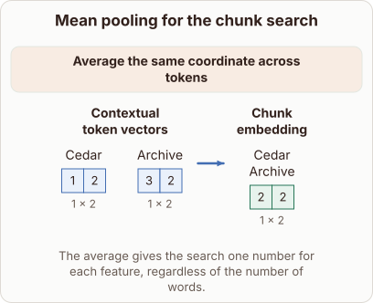

# Mean pooling for the chunk search in RETRO

- Prompt (reference.prompts[0]): How does RETRO average token vectors into one chunk embedding?
- Reference id: figure-retro-chunk-embedding (source: Retrieval Transformer)
- Intended kind (reference.spec.diagram.kind): transformation
- Planner kind: transformation (fixed); planner routed to picture: no
- Model kind (first diagram): transformation; all diagrams: transformation
- Selector hit (intended reference among the references sent): yes
- References sent to the author (attempt 0): shape-transformation, figure-retro-chunk-embedding, cosine-vector-directions
- Structure (faithful-ref-v1, reference vs model spec): fully - The diagram matches the reference. It has the same transformation structure: two 1×2 token vectors (1,2 and 3,2) are averaged into one 1×2 chunk embedding (2,2). The operation label and caption are the same.
- Factual (factual-v2): 5/5, error no
- Repaired: no; visual fallback: no; authored by google / gemini-3.5-flash-lite
- Time 3145 ms; author tokens in/out 4118/500; cost US$0.002486

| model (408 px) | reference (408 px) |
|---|---|
|  |  |

## Card body (as saved)

RETRO pools tokens into a single chunk vector to query an external database.

```rh-diagram
{"version":1,"diagram":{"title":"Mean pooling for the chunk search","caption":"The average gives the search one number for each feature, regardless of the number of words.","kind":"transformation","before":{"label":"Contextual token vectors","items":[{"label":"Cedar","tensor":{"rows":1,"columns":2,"dimensions":"1 x 2","values":[1,2],"role":"input"}},{"label":"Archive","tensor":{"rows":1,"columns":2,"dimensions":"1 x 2","values":[3,2],"role":"input"}}]},"after":{"label":"Chunk embedding","items":[{"label":"Cedar Archive","tensor":{"rows":1,"columns":2,"dimensions":"1 x 2","values":[2,2],"role":"output"}}]},"operation":"Average the same coordinate across tokens"}}
```

It computes the arithmetic mean across all token vectors within that chunk. This yields one fixed-size representation for the whole chunk.
