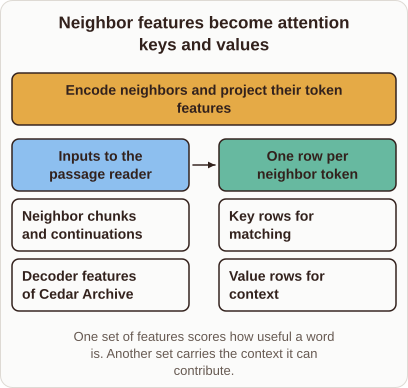
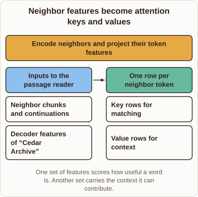

# Neighbor features become attention keys and values

- Prompt (reference.prompts[0]): How do the retrieved words become keys and values in RETRO?
- Reference id: figure-retro-encoded-neighbor-rows (source: Retrieval Transformer)
- Intended kind (reference.spec.diagram.kind): transformation
- Planner kind: transformation (reference override; the planner said flow); planner routed to picture: no
- Model kind (first diagram): transformation; all diagrams: transformation
- Selector hit (intended reference among the references sent): yes
- References sent to the author (attempt 0): shape-transformation, figure-retro-encoded-neighbor-rows
- Structure (faithful-ref-v1, reference vs model spec): fully - The diagram matches the reference: a transformation with the same before items, the same operation, the same after items (key rows and value rows) and the same caption. Only the quote marks around "Cedar Archive" differ.
- Factual (factual-v2): 5/5, error no
- Repaired: no; visual fallback: no; authored by google / gemini-3.5-flash-lite
- Time 2521 ms; author tokens in/out 3845/480; cost US$0.002354

| model (408 px) | reference (408 px) |
|---|---|
|  |  |

## Card body (as saved)

RETRO retrieves neighbor chunks from an external database to aid language modeling. These retrieved text passages must be transformed into vectors that the model can attend to.

The model processes the neighbor tokens through dedicated encoder layers to extract dense representations.

```rh-diagram
{"version":1,"diagram":{"title":"Neighbor features become attention keys and values","caption":"One set of features scores how useful a word is. Another set carries the context it can contribute.","kind":"transformation","before":{"label":"Inputs to the passage reader","items":["Neighbor chunks and continuations","Decoder features of Cedar Archive"]},"after":{"label":"One row per neighbor token","items":["Key rows for matching","Value rows for context"]},"operation":"Encode neighbors and project their token features"}}
```

These token representations are then projected into two distinct sets. One projection forms the keys for similarity scoring, and the other forms the values providing context.
