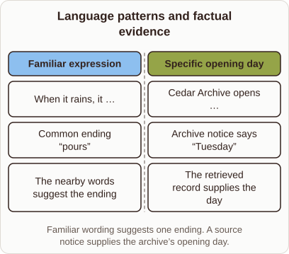

# Language Patterns and Factual Evidence

- Prompt (reference.prompts[0]): Why would a retrieval model need a text store for facts but not common phrases?
- Reference id: figure-retro-fact-versus-pattern (source: Retrieval Transformer)
- Intended kind (reference.spec.diagram.kind): comparison
- Planner kind: comparison (not fixed; offered comparison | token-links); planner routed to picture: no
- Model kind (first diagram): comparison; all diagrams: comparison
- Selector hit (intended reference among the references sent): yes
- References sent to the author (attempt 0): shape-comparison, figure-retro-fact-versus-pattern
- Structure (faithful-ref-v1, reference vs model spec): fully - The diagram matches the reference. It is a two-column comparison with the same title, headings, items and caption.
- Factual (factual-v2): 4/5, error no - Minor overgeneralization: models also store many frequent facts in weights; retrieval is needed mainly for rare, new, or private facts.
- Repaired: no; visual fallback: no; authored by google / gemini-3.5-flash-lite
- Time 3232 ms; author tokens in/out 3808/454; cost US$0.002278

| model (408 px) | reference (408 px) |
|---|---|
|  |  |

## Card body (as saved)

Language models store common phrases in their weights because such patterns repeat often across training texts. These predictable sequences do not change, so the network internalizes them during training.

```rh-diagram
{"version":1,"diagram":{"title":"Language patterns and factual evidence","caption":"Familiar wording suggests one ending. A source notice supplies the archive’s opening day.","kind":"comparison","columns":[{"heading":"Familiar expression","items":["When it rains, it …","Common ending “pours”","The nearby words suggest the ending"]},{"heading":"Specific opening day","items":["Cedar Archive opens …","Archive notice says “Tuesday”","The retrieved record supplies the day"]}]}}
```

Specific facts require an external text store because unique data points cannot be guessed from general wording. Retrieving these documents supplies the exact details required for correct answers.
