# RETRO Index Storage

- Prompt (reference.prompts[0]): What does RETRO keep with each search key in its retrieval index?
- Reference id: figure-retro-index-records (source: Retrieval Transformer)
- Intended kind (reference.spec.diagram.kind): matrix
- Planner kind: matrix (reference override; the planner said tree); planner routed to picture: no
- Model kind (first diagram): matrix; all diagrams: matrix
- Selector hit (intended reference among the references sent): yes
- References sent to the author (attempt 0): shape-matrix, figure-retro-index-records
- Structure (faithful-ref-v1, reference vs model spec): partly - The diagram is a matrix with the same three columns and records A and B with matching content. It omits records C and D, and it has no highlighted rows distinguishing the contributing records from the others. The core structure is only partly shown.
- Factual (factual-v2): 5/5, error no
- Repaired: no; visual fallback: no; authored by google / gemini-3.5-flash-lite
- Time 3081 ms; author tokens in/out 3825/322; cost US$0.001953

| model (408 px) | reference (408 px) |
|---|---|
|  |  |

## Card body (as saved)

RETRO stores chunks of text alongside their vector embeddings in an external database.

```rh-diagram
{"version":1,"diagram":{"title":"RETRO retrieval index records","caption":"The index maps chunk keys to matching text and continuation words.","kind":"matrix","layout":"teaching","columns":["Embedding key","Matching words","Following words"],"rows":[{"id":"A","heading":"Record A","cells":["$[2,3]$","Cedar archive","opens Tuesday"]},{"id":"B","heading":"Record B","cells":["$[4,2]$","Archive doors","open Tuesday"]}]}}
```

For each search key, it preserves the exact matching text block and the subsequent continuation words.
