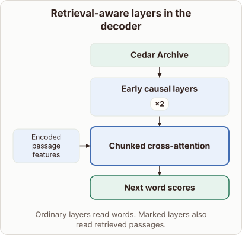
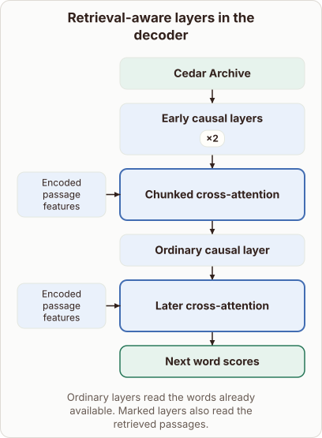

# Retrieval-aware layers in the RETRO decoder stack

- Prompt (reference.prompts[0]): Where do the retrieved neighbors first enter the RETRO decoder stack?
- Reference id: figure-retro-layer-placement (source: Retrieval Transformer)
- Intended kind (reference.spec.diagram.kind): block-stack
- Planner kind: block-stack (reference override; the planner said layers) (fixed); planner routed to picture: no
- Model kind (first diagram): block-stack; all diagrams: block-stack
- Selector hit (intended reference among the references sent): yes
- References sent to the author (attempt 0): shape-block-stack, figure-retro-layer-placement, knn-neighbourhood
- Structure (faithful-ref-v1, reference vs model spec): partly - The diagram has the block-stack, the repeated early causal layers, and the first chunked cross-attention with passage features. It is missing the ordinary causal layer and the later cross-attention block with its own encoded passage features input. That drops the interleaving the reference shows.
- Factual (factual-v2): 5/5, error no
- Repaired: no; visual fallback: no; authored by google / gemini-3.5-flash-lite
- Time 3920 ms; author tokens in/out 4090/477; cost US$0.00242

| model (408 px) | reference (408 px) |
|---|---|
|  |  |

## Card body (as saved)

RETRO interleaves causal self-attention layers with dedicated cross-attention blocks that ingest external retrieved chunks.

```rh-diagram
{"version":1,"diagram":{"title":"Retrieval-aware layers in the decoder","caption":"Ordinary layers read words. Marked layers also read retrieved passages.","kind":"block-stack","blocks":[{"id":"input","label":"Cedar Archive","role":"embedding"},{"id":"causal","label":"Early causal layers","repeat":2,"role":"attention"},{"id":"retrieval","label":"Chunked cross-attention","role":"changed","inputs":[{"label":"Encoded passage features"}]},{"id":"out","label":"Next word scores","role":"output"}]}}
```

Initial token representations pass through ordinary causal layers before reaching the first specialized cross-attention block, which acts as the entry point for neighbor features.

These injected passage representations allow the model to condition generated text on retrieved text chunks.
