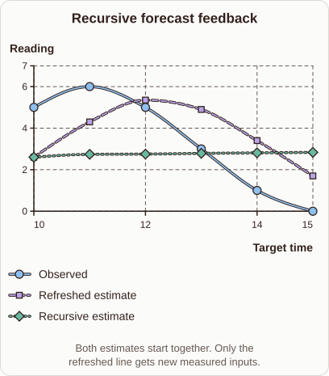

# Why Recursive Forecasts Drift

- Prompt (reference.prompts[0]): Why can a recursive forecast drift when it feeds its own predictions back?
- Reference id: d2l-forecast-feedback-error (source: D2L)
- Intended kind (reference.spec.diagram.kind): coordinate-plot
- Planner kind: coordinate-plot (reference override; the planner said cycle) (fixed); planner routed to picture: no
- Model kind (first diagram): coordinate-plot; all diagrams: coordinate-plot
- Selector hit (intended reference among the references sent): yes
- References sent to the author (attempt 0): shape-coordinate-plot, d2l-forecast-feedback-error, ml-recursive-vs-direct-forecast
- Structure (faithful-ref-v1, reference vs model spec): fully - The diagram matches the reference exactly. It is a coordinate plot with the same title, axes, three series and points, and the same caption.
- Factual (factual-v2): 3/5, error yes - Misleading: flattening of recursive forecasts is typically mean reversion/damping of the model, not caused by error accumulation; also the 'refreshed' line (new measurements) is conflated with direct forecasting.
- Repaired: no; visual fallback: no; authored by google / gemini-3.5-flash-lite
- Time 4911 ms; author tokens in/out 4495/949; cost US$0.003721

| model (408 px) | reference (408 px) |
|---|---|
|  |  |

## Card body (as saved)

When a model predicts one step ahead and uses that prediction as an input for the next step, any small error compounds over time.

This feedback loop replaces true observations with estimated values, causing the trajectory to drift away from reality.

```rh-diagram
{"version":1,"diagram":{"title":"Recursive forecast feedback","caption":"Both estimates start together. Only the refreshed line gets new measured inputs.","kind":"coordinate-plot","x":{"label":"Target time","min":10,"max":15},"y":{"label":"Reading","min":0,"max":7},"series":[{"label":"Observed","kind":"line","points":[{"x":10,"y":5},{"x":11,"y":6},{"x":12,"y":5},{"x":13,"y":3},{"x":14,"y":1},{"x":15,"y":0}]},{"label":"Refreshed estimate","kind":"line","points":[{"x":10,"y":2.6},{"x":11,"y":4.3},{"x":12,"y":5.35},{"x":13,"y":4.9},{"x":14,"y":3.4},{"x":15,"y":1.7}]},{"label":"Recursive estimate","kind":"line","points":[{"x":10,"y":2.6},{"x":11,"y":2.74},{"x":12,"y":2.751},{"x":13,"y":2.786},{"x":14,"y":2.811},{"x":15,"y":2.834}]}]}}
```

As seen in the plot, the recursive estimate flattens out because errors accumulate and distort subsequent steps. Direct forecasting avoids this by keeping observed history as inputs for every horizon.
